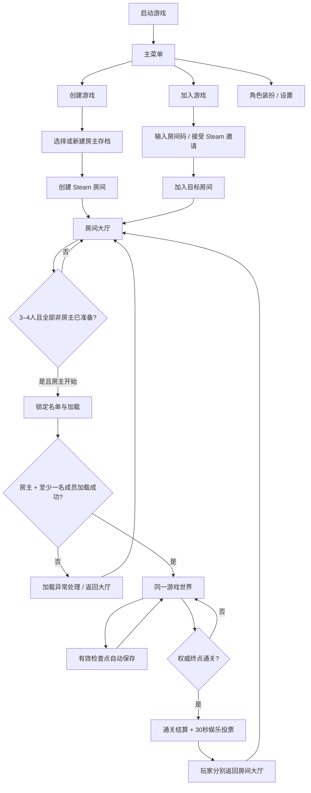
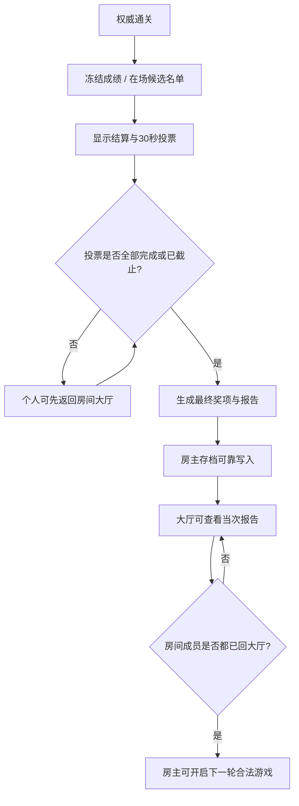

# 《搬鱼缸》正式版游戏流程与基础系统策划案 V1.1（全量修订版）
> **2026-10-16 新场景覆盖决定：** 以Git正式第一版白盒为准，鱼缸出生点保留模型中央单柱，存档点不生成立柱。完整鱼缸到达黄点附近即激活，不要求放下；人物单独经过不算，同一物理步碎缸优先。此前四柱接触规则在当前正式白盒中由本决定替代；旧实验场保留用于历史对照。高处黄球为中途存档点，路线末端终点仍等待策划模型，本次不新增临时终点。
> **2026-10-15 用户决策覆盖（后续实施优先）：** 正式版保留 **2～4 人开局**，房主单人可创建房间，所有已入房非房主成员均准备才可开始；只有房主一人不能开局。实际进入世界仍须房主与至少一位成员完成加载。下文原“3～4 人开局”“未满 3 人不能开始”及对应 SYS 用例的人数门槛统一按此修订，历史原文保留供追溯。其他系统按本策划逐步实施，包括普通成员掉线后其余人继续、原成员从 CP 重连。伸缩 B 仍按独立实验管理，本覆盖不将其转为正式默认操作。

> **文件类型**：Markdown / 面向程序落地的系统策划需求  
> **编制日期**：2026-10-14  
> **适用产品**：计划在 Steam 发行的 PC 正式版《搬鱼缸》（Unity）  
> **读者**：客户端程序、联机/网络程序、UI/美术、主策划、关卡策划、测试  
> **状态**：**主要玩家可见规则已冻结并按 2026-10-14 最新确认修订；具体趣味称号、装扮内容、若干技术实现与边界交互仍待后续设计/评估，不代表全部功能已实现或验收**  
> **重要区分**：这是**正式发行目标规格**，不是《程序开工资料包 V12》的 M0/M1/M2/M3 当前里程碑承诺。**正式版对 V12 D-06 的新增修订以本文为准，仅适用于后续正式版范围；不追溯改变 V12 已定的阶段验收基线。**

---

## 00. 阅读说明与版本边界

### 00.1 本文件要解决什么

定义玩家从打开 Steam 游戏，到创建/加入房间、选存档、装扮、准备、多人游玩、按 ESC、按键同意返回检查点、掉线重连、保存进度、四柱触发终点结算、再次挑战、退出游戏的**全部基础系统行为**。每个模块尽量交代：**进入条件 → 可见信息 → 玩家操作 → 系统响应 → 特殊情况 → 验收方式**。

**不替代**核心玩法需求、物理参数文档、关卡施工图、教学策划案或程序架构设计。本文提及鱼缸与关卡时主要约束系统对既有机制的调用与反馈；**例外：本版已由主策划正式明确四根指定安全柱同一权威物理步同时接触即激活检查点/终点，危险接触同一步优先，属于正式版对旧 D-06 触发条件的明确修订**。抓取、受力、其他伤害碰撞规则仍以既有核心文件为准。

### 00.2 需求标记（阅读时必须区分）

| 标识 | 含义 | 是否可直接作为验收目标 |
|---|---|---|
| **【F】已确认** | 本项目讨论中由主策划明确选定的正式版玩家可见规则，或对应来源 D-01～D-12 已确认的核心规则 | 是；若技术不可行，先反馈并重新审批 |
| **【D】按已确认规则推导** | 为形成完整流程而从既有规则直接推导出的必要条件，不引入新的玩法能力 | 可作为草案验收基线；若推导有争议，评审时纠正 |
| **【P】方案建议** | 本文补充的细节、默认文案、超时时间、页面布局或工程可行性方案，尚未经主策划逐项确认 | 不作为冻结标准；需在界面评审/联调前确认 |
| **【T】程序评估** | 玩家目标已明确，但联机、数据、异常技术实现和具体数值需要程序提供方案与证据 | 先验收评估结果；技术可行后转为功能测试 |
| **【U】待主策划确认** | 现有资料不能唯一决定的玩家可见结果，不允许程序自行定成正式玩法 | 否；需要产品确认后更新版本 |

说明：表格中若写“推荐”“暂定”“例如”，一律按【P】理解；不能因写进 V1.0 就视为主策划已冻结。本文会专门汇总所有【U】与重要【T】。

### 00.3 来源优先级与适用边界

1. **核心玩法原型**：`03_规则确认清单_D01-D12_V1.0.md` ＞ `02_核心交互规则补充_V1.12.md` ＞ `01_核心玩法程序需求策划案_V1.0_历史基线.md`。详见 V12 `00_阅读指南_V12.md`。**正式版特定例外**：四柱接触触发、同一步危险碰撞优先、终点四柱通关采用本文最新决策；V12 原型仍执行原里程碑基线。
2. **正式版外围系统**：以 2026-10-14 前由主策划连续确认的正式版系统决策为本文件直接依据；本文新增系统不自动覆盖 V12 的既有里程碑验收范围。
3. 当正式版的**玩家可见结果**有新增或变化，必须在本文件说明与旧规则的关系；当只是算法/框架变化，允许程序自主选择，但不得暗改用户体验。
4. `前三关关卡设计.html` V1.1 是连续白盒、检查点和归队路线的关卡协作依据。正式版关卡数量、场景几何尺寸不在本文件冻结；**终点的系统成功触发条件已冻结为四根指定安全柱同一步同时接触且同一步无危险接触**，具体终点位置/演出仍由关卡设计。
5. `立项质检规则.html` 用于玩法概念/原型/立项质检，不替代本文件的系统功能验收。

### 00.4 范围

**正式版必备系统方向【F】**：Steam 身份及好友邀请、房间码入房、**房主单人即可创建房间，3–4 人准备后才能开局**、3D 角色展示及个人装扮入口、五存档、四柱接触检查点/终点、跨会话计时、HUD、ESC、**P（可改键）同意复位投票**、设置、断线重连、最终结算、跨会话娱乐统计与投票、历史通关记录。具体趣味称号名称和装扮内容后续另行设计【U】。

**不纳入本文件的正式版必做功能【F/已排除或暂不考虑】**：公开匹配与陌生人房间浏览、正式版 AI 队友、游戏内语音、按队伍持有的存档、游戏中允许新人中途加入、存档复制、复杂社交账号体系。手柄完整适配为后续评估；游戏教学已有单独设计，本文件只衔接入口与输入，不重写教学。

**Demo 与正式版的区别【F】**：Demo 的 AI 仅用于内部研发/测试补位；**正式版不设计或要求 AI 队友**。V12 原型也未把 AI 列为既有交付项，Demo AI 是单独新增的研发工具需求，不能挤占本文件正式系统的默认范围。

### 00.5 统一术语

| 名称 | 含义 |
|---|---|
| **Steam 身份** | 玩家稳定的 Steam 唯一身份标识，昵称/头像是可变展示信息；同房/重连/统计不可仅靠昵称识别 |
| **房主** | 创建当次游戏房间、选择所用存档并持有该存档的玩家；不等于技术架构中的“物理权威端” |
| **房间** | 一次临时组队的大厅与对应对局会话；房间码仅用于加入，不是存档 ID |
| **存档位** | 房主账号下五个独立的长期冒险存档之一 |
| **冒险轮次（Run）** | 某一存档从 CP0 起到一次通关的进度周期；已通关存档“重新挑战”启动新轮次 |
| **检查点（CP）** | 鱼缸在**同一权威物理模拟步**真实同时接触该 CP 的四根指定安全柱、且同一步未接触危险物时立即激活的复位/进度点；不要求额外停稳、等待、松手或角色触线 |
| **终点四柱** | 终点设置的四根指定安全柱；以与 CP 相同的同一步四点真实接触和危险优先规则确认通关，但只触发一次通关而非普通进度 CP |
| **待重新挑战（Pending Replay）** | 已通关存档在大厅选择重玩后产生的**会话级待启动意向**，此时存档原已通关状态及历史数据完全不变；达到有效游戏世界开局条件后才创建新 Run |
| **系统投票同意键** | 默认 `P`，可在个人控制设置中改键；仅在当前有有效检查点复位投票时接收一次新的按下事件，不代替结算 MVP/背锅王的选择界面 |
| **锁定名单** | 房主点击开始时确认的本局 3–4 名成员身份；在本局结束前不能由新成员补位 |
| **在线成员** | 当前被权威会话确认为已连接并参与游戏的成员；不等于仅在锁定名单上 |
| **断线预留成员** | 属于锁定名单，但尚未成功载入或已经确认掉线，允许以原 Steam 身份重连的人 |
| **主动离队** | 玩家通过游戏提供的退出流程明确离开当前对局；不保留当局重连资格 |
| **结算报告** | 一次通关后的不可变成绩与奖项快照；完整历史归属于房主存档 |

### 00.6 产品级不可破坏的约束

- **【F】房主可单人创建并持有房间；只有 3–4 名真人在大厅且非房主均已准备，才能发出正式开局指令；不提供 AI 填充。** 游戏已经开始后在线人数可以降至 2 甚至 1，不自动失败，也不自动结束。
- **【F】对局开始即锁定名单**；拒绝新玩家中途加入，允许锁定名单上的原成员重连。主动离队者从当前局名单的有效重连资格中移除。
- **【F】存档只属于房主个人 Steam 身份**；换队友不影响进度，非房主不能凭参与他人房间继承检查点。
- **【F】只有鱼缸在同一权威物理步同时真实接触某检查点的四根指定安全柱、且该步无危险接触，才可激活新的 CP 并推进关卡进度**；终点采用相同触发逻辑进入通关。计时与行为统计可独立持久化，不代表可在任意位置恢复。
- **【F】ESC、Steam Overlay、失去应用焦点不会暂停世界；主动抓取应释放**，但合法被动头顶支撑不因此取消。
- **【F】正常玩家离队不影响其他在线成员继续**；房主正常退出会解散房间。房主意外掉线需技术评估，无法安全继续时执行批准的降级方案。
- **【F】除本版明确修订的四柱判定外，游戏世界中的鱼缸碰撞、角色死亡与正常复位仍须遵守 V12 的 D 项；外围系统不能借菜单、保存或重连绕过它们。**
- **【F】正式版关于检查点/终点触发以本版四柱同一步接触规则为准**；同一步存在危险接触时鱼缸破碎优先，CP/终点均不成功。其余 V12 D-01～D-12 既有行为保持有效，不能把本次例外扩展为随意改造其他核心玩法。
- **【F】手动返回 CP：房主发起即自动同意；其他发起时在线的成员以默认 `P`（可改键）按键表示同意；不设反对键，20 秒未按即视为未同意。**

---

## 01. 全局页面、状态与完整玩家流程

### 01.1 页面清单

| ID | 页面/叠层 | 进入入口 | 主要去向 |
|---|---|---|---|
| UI-01 | 主菜单 | 游戏成功启动、离开/被移出房间后 | 创建游戏、加入游戏、角色装扮、设置、退出程序 |
| UI-02 | 存档选择/管理 | 主菜单“创建游戏”、大厅内房主“切换存档” | 创建房间/返回原大厅或菜单 |
| UI-03 | 加入房间 | 主菜单“加入游戏” | 房间大厅/返回主菜单 |
| UI-04 | 房间大厅 | 创建房间成功、输入码加入、接受有效 Steam 邀请、通关结算返回 | 装扮、准备/开始、切换存档、离开 |
| UI-05 | 角色装扮 | 主菜单或大厅 | 返回来源页面 |
| UI-06 | 加载/联机建立 | 房主开始；重连中的原成员 | 游戏世界/大厅/错误提示 |
| UI-07 | 游戏 HUD | 角色成功进入游戏世界 | ESC、结算、主菜单（离队/房间结束） |
| UI-08 | ESC 菜单 | 游戏中按 ESC | 继续游戏、设置、复位投票、退出确认 |
| UI-09 | 设置 | 主菜单或 ESC | 返回来源页面 |
| UI-10 | 复位投票层 | 房主发起 | 继续游戏/检查点复位/失败提示 |
| UI-11 | 通关结算 | 收到权威通关事件 | 房间大厅；可查看投票/个人数据 |
| UI-12 | 结算历史详情 | 房主存档界面；当次房间报告入口 | 返回存档选择/大厅 |
| UI-13 | 全局确认/异常提示 | 需要二次确认或发生错误 | 按异常恢复路径返回相应页面 |

### 01.2 正常主流程（正式版）



> Mermaid 只示意主路径；房主退出、断线重连、进度恢复、多人投票和保存失败按后文状态规则处理。

### 01.3 系统状态优先级【D】

- 一名玩家的**当前页面**与其**多人会话身份**分开管理：返回结算大厅只是离开结算界面，不等于当前房间解散；ESC 只是本地 UI 状态，不等于物理世界暂停。
- 房间创建、存档选择和名单锁定为不同动作；只有“创建房间成功”才生成有效房间标识与邀请码，**创建时仅房主一人合法**；只有“锁定名单”之后才禁止新人加入。
- 一次检查点激活、一次碎缸、一次通关结算只能产生**一次**权威结果；异常重试不得复制记录或重复计数。**复位出生在四柱上不算一次新激活**；同一步危险接触与四柱接触竞争时危险优先。
- UI 必须以实际已确认状态显示，不能仅因按钮点击就提前宣告“成功创建”“成功保存”“已重连”“已通关”。

---

## 02. 启动、主菜单与 Steam 身份

### 02.1 启动行为

**【F】目标平台 Steam PC，Unity 正式构建。** 玩家启动游戏后进入主菜单；展示当前 Steam 昵称/头像属于基础产品方向。游戏可以依赖 Steam 平台能力，但程序必须说明 Steam 未就绪时的实际结果，不得假定所有 Unity EXE 启动方式都会自动获得完整 Steam 身份与邀请能力【T】。

**【P】推荐步骤**：启动 → 检查必要本地资源与配置 → 尝试初始化 Steam 身份与平台联机入口 → 进入主菜单。若 Steam 不可用，显示明确失败原因与“重试/退出”；是否允许离线浏览装扮或设置由程序给出能力边界后再定【U】。

### 02.2 主菜单冻结按钮【F】

固定展示五个一级入口，**不额外设置“开始游戏”中转页面**：

| 按钮 | 点击行为 | 返回路径 |
|---|---|---|
| **创建游戏** | 打开本人存档选择/管理页面；选定后创建房间成为房主 | 返回主菜单 |
| **加入游戏** | 打开房间码输入界面；可通过 Steam 邀请绕过手动输入 | 返回主菜单 |
| **角色装扮** | 打开个人装扮界面 | 返回主菜单 |
| **设置** | 打开本人的设置界面 | 返回主菜单 |
| **退出游戏** | 请求关闭整个程序；【P】建议退出确认，避免误点 | 取消则保留主菜单 |

**【P】展示辅助信息**：当前 Steam 昵称/头像、当前版本号、必要的网络状态；不作为新增账号系统入口。

### 02.3 Steam 邀请跳转【F/D】

- 在主菜单接受有效的 Steam 游戏邀请：**直接进入目标房间大厅**，无须再输入房间码。
- 如果当前已在另一个大厅、已进入关卡或仍处于结算阶段：先弹出“离开当前会话并加入其他房间？”确认；拒绝不改变原会话。接受后**先按原会话的退出/保存/清理规则完成离开**，然后加入邀请房间。不能直接跨会话传送。
- 房间已经开始且邀请者不是本局锁定名单中的可重连成员：拒绝加入，显示“对局已开始，无法中途加入”。
- **【T】** Steam Overlay、好友邀请回调、房间码及 Steam 身份映射的具体接入由程序评估；“加 Steam 好友 + Unity EXE + 输入房间码已跑通四人”仅可证明一次测试流程有效，**不能据此宣布正式 Steam Lobby、邀请或重连都已完成**。

---

## 03. 个人存档、冒险进度与历史记录

### 03.1 所有权和上限【F】

- 每个玩家账号**最多 5 个独立存档**。只由该账号在担任房主并选择某个存档时推进该存档。
- 不存在“跟随队伍的共享存档”。今天 A 与 B/C/D 到 CP2，明天 A 与 E/F/G 继续，依旧从 A 存档的 CP2 开始。B/C/D 自己开房无法通过昨天当客人的游玩取得 A 的 CP2。
- 存档与房间分离：关闭房间不删除存档；房间码变化不改变存档；换队友不清空存档。
- 【F】存档管理支持：**新建、选择/继续、重命名、查看详情、删除**；**不支持复制存档**。

### 03.2 存档选择页

| 页面元素 | 行为 | 标记 |
|---|---|---|
| 5 个存档位 | 有存档显示名字、当前 CP、累计时间、通关状态；空位可新建 | 【F】核心字段；排版【P】 |
| 选择存档 | 进入创建房间（从主菜单）或切换大厅绑定存档（仅房主） | 【F】 |
| 存档详情 | 显示当前冒险信息，历史通关次数、历次成绩、历史最佳；可进入某次通关报告 | 【F】 |
| 重命名 | 修改当前存档显示名，不改身份/进度/统计 | 【F/D】 |
| 删除 | 需要二次确认，永久清除该存档当前进度与历史记录 | 【F/D】；具体恢复/撤销能力【U】 |
| 满 5 个存档 | 不允许新建，提示需要先清理旧存档 | 【D】 |
| 已通关存档 | 保留历史记录，提供明确“重新挑战”入口 | 【F】 |

**【P】存档可显示“上次游玩时间/参与者”等辅助信息，具体样式由 UI 设计。** 不能把示例 CP 编号当作最终关卡总量。

### 03.3 当前冒险（Run）、待重新挑战状态与永久历史分离【F/D】

同一存档含两类生命周期不同的数据：

| 数据层 | 内容 | 何时重置 |
|---|---|---|
| **当前冒险轮次** | 当前有效 CP、该轮累计有效游玩时间、该轮碎缸次数、各成员个人行为累计、当前轮次成员集合、通关状态 | 已通关后**确认“重新挑战”只是待启动**；**房主+至少一位成员实际成功进入新的游戏世界时**，才创建新 Run 并从 CP0 重新计数 |
| **永久通关历史** | 每次已完成的通关报告、通关次数、历史最好成绩、每次最终会话成员身份及奖项 | 重新挑战**不删除**；只有玩家删除整个存档才按删除规则处理 |

**【F】已通关存档可以重新从起点挑战**，之前成绩永久保留；不能因再次点击房主“开始游戏”而静默清空旧记录或已通关状态。  
**【F】重新挑战采用“先待启动，后提交”**：已通关存档被选为大厅绑定存档 → 房主明确点击“重新挑战”并确认 → 房间标记为**待重新挑战**，大厅显示“本次将从起点重新挑战”，**原 Run 和历史仍原样有效** → 全体非房主重新准备 → 合法锁定 3–4 人 → **房主和至少一位其他成员成功加载、真正进入新游戏世界时，才一次性正式生成并启用新 Run（CP0、计时 0、碎缸 0、个人行为统计 0）**。  
- **【F】取消、解散房间、未凑足人数、加载失败而未达到入世界条件**：均不得提前创建/覆盖新 Run；原存档保持已通关，可日后再试。  
- **【F】一旦两人成功进入新世界、实际开始新 Run**：即使随后掉线/主动退出，新 Run 已成立，不能自动回滚成旧的已通关 Run；历史报告依旧不变。  
- **【D/T】数据提交必须只发生一次**，程序保证新 Run 开始与存档写入的一致性：启动提交失败时不得谎称新 Run 已可持久保存，且不能损伤旧通关记录；具体失败恢复由程序提出。  
- **【D】** 切换大厅绑定存档、取消待重新挑战，应清除**该房间临时待启动标记**，不得因此修改任何原有长期存档。  
**【U】** 已通关存档是否允许房主仅查看终点场景尚无需求，不应自行加入正式功能。

### 03.4 关卡进度何时推进【F：正式版修订 D-06 的触发判定】

- 检查点各配置**四根指定、合法接触不会碎缸的安全柱**。共享鱼缸在**同一个权威物理模拟步**中同时与这四根柱子发生**真实有效接触**，且同一步**没有任何危险物接触**，**立即**激活该新 CP；不要求角色齐聚、停止运动、保持 N 秒、四名玩家松手、额外停车键或速度阈值。
- 只接触 1～3 根安全柱不激活；四根依次碰到但**从未在同一个模拟步全部同时接触**也不激活；角色经过或鱼缸穿过停车区域而不具备四柱同时接触不激活。
- 若**同一权威物理模拟步**发生四柱有效接触与任何危险环境碰撞：**危险碰撞优先，鱼缸按 D-07 碎裂，该步不激活 CP**。若 CP 已在较早有效模拟步成功激活，后续模拟步才碎缸，则保留已确认 CP，不回退合法进度。
- 四根安全柱属于 D-07 的安全接触例外；周边危险墙面/地面仍真实接触即碎。不能将非柱的危险物误归入安全区域，也不能加大隐藏容错代替真实接触。
- 新 CP **权威有效激活并成功完成进度持久化**后，后续退出重进从该 CP 的合法安全初始状态开始，**不是**从退出瞬间的角色/鱼缸位置继续。
- 鱼缸碎裂、菜单主动复位、技术异常复位所产生的**系统生成/恢复接触**不得重复触发 CP；即使恢复后的鱼缸正好与四柱接触，也不增加 CP 激活数、不再次宣告成功。鱼缸碎裂属于单局回最近已激活 CP，玩家中途退出不增加 CP。
- **【F】旧 V12 D-06 中额外的“放置成有效承托/停稳程度尚待确定”不再作为正式版激活的附加必要条件**；这是 2026-10-14 对正式版的明确修订，原 V12 M2 的历史版本验收不被本文件追溯覆盖。
- **【T】** 程序仍须提出可靠的四个独立接触对象识别、权威模拟步、接触状态一致性、物理噪声处理、事件去重与日志方案，并进行实机验证；不能借技术去抖悄悄增加玩家可感知的等待/停稳条件。

### 03.5 与检查点独立持久化的统计【F】

**进度与统计分开：**

- **检查点索引**只按合法新 CP 的四柱同时接触且同一步无危险接触的权威确认推进；不能因正常退出/切换菜单/断线/系统复位出生而前进。
- **累计冒险时间、实际碎缸次数、个人行为事件**可在 CP 之外独立持久化。即使玩家在 CP2 到 CP3 之间连续挑战两小时未成功并退出，这两小时与期间真实事件仍保留，但重进仍从 CP2 开始。
- 每次游戏加载、游玩、退出、重开、通关均须以唯一的**存档 ID + 冒险轮次 ID**归档，不能出现存档 01 的统计误写至存档 02。待重新挑战期间不得生成第二套正式 Run 统计；只有实际开局成功后才开始归属于新 Run。
- 统计写入应能处理正常退出、重试、网络抖动及进程异常；**【T】** 数据落盘策略、频率、原子性和回滚由程序提出，确保已确认写入的数据不因单次失败轻易被覆盖。

### 03.6 保存失败与数据安全

**【D】玩家可见底线**：未成功保存，不显示“已保存”；已成功保存，不得因再次加载或重复写入意外倒退到旧 CP；同一事件不得重复累加；存档损坏不能自动覆盖原有有效数据。

**【T】程序至少评估**：本地文件/Steam Cloud/其他方案；原子写入及备份恢复；跨设备与云同步冲突；异常关机；本地时间篡改；多实例启动；写失败重试；房主掉线期间是否可能可靠持久化。是否引入 Steam Cloud 由程序评估，**不是本文件已确认的强制接入项**。

**【U】需要技术方案后再拍板**：通关数据保存失败时是否允许房主离开但暂存待补写；连续写失败时是否强制阻止解散、如何告知恢复路径。原要求是“房主退出前先完成有效结算保存”，但不能用无限不可关闭弹窗代替可恢复性设计。

### 03.7 存档内容的建议逻辑模型【T/P，非强制代码结构】

```text
SteamAccount
  ├─ PlayerSettings（个人操作/画面/声音/语言）
  ├─ CosmeticProfile（个人装扮）
  └─ SaveSlots[0..4]
        ├─ SaveId, DisplayName
        ├─ CurrentRunId, CurrentCheckpoint
        ├─ CurrentRunElapsedSeconds, CurrentRunGlassBreakCount
        ├─ CurrentRunParticipantStats[SteamId -> counters]
        └─ CompletedRunReports[]
              ├─ RunId, FinalElapsedSeconds, GlassBreakCount, CPCount
              ├─ FinalSessionMembers[SteamId, SnapshotName]
              ├─ AutomaticTitles[TitleId, WinnerSteamIds]
              └─ VotesAndAwards[MVP, Blame]
```

存储字段、日志冗余和身份安全方案由程序设计。保存展示昵称快照，不应把昵称当唯一键。历史参与者可能已经不在最终房间，需要仍能在报告中显示对应称号。

---
## 04. 创建房间、房间码与 Steam 加入

### 04.1 创建流程【F】

1. 主菜单点击「创建游戏」→ 进入本人的五存档选择页。
2. 选择已有存档或新建一个存档（已通关存档遵循“重新挑战待启动”专门确认流程）。
3. 房主**一人就可**请求创建临时多人房间；创建成功后成为房主，进入房间大厅。**不需要先等 3 人到场才能创建房间**，人数校验仅用于房主点击“开始游戏”。
4. 房间展示**可分享的房间码**和 Steam 邀请入口，可邀请另外 2–3 名真人入房。
5. 房间容量最多 4 人。房主允许在大厅中更换绑定存档，详见 §05。

**【T】** 创建会话失败、Steam 平台不可用、网络不可达、房间码生成与唯一性由程序评估。客户端只有收到成功状态才可以展示可用房间码，不得显示伪造的成功码。

### 04.2 房间码加入【F】

1. 玩家主菜单点击「加入游戏」→ 输入朋友提供的房间码。
2. **无须先成为 Steam 好友，也不需要房主审批**；输入的房间码有效、会话可加入且尚有空位，便直接进入大厅。
3. 加入前需要具备可供房间标识和权限校验的 Steam 玩家身份；“不是 Steam 好友”并不等于可以绕过 Steam 身份进入正式版【D/T】。
4. 房间已满、房间码不存在/失效、游戏已开始、被该房间踢出、连接失败时均不进入房间，以清晰文案告知原因。
5. 连接中不可因反复点击而进入两次房间、创建两个角色或占两个位置【D】。

### 04.3 Steam 好友邀请【F】

- 房主和所有在房成员均可发出 Steam 好友邀请；也都可复制/分享房间码。
- 好友接受有效邀请后直接进入目标房间大厅；不要求再次输入码。
- 进入条件与房间码完全一致：有效空位、房间未锁定、未被当前房间禁止加入。
- 非本局成员通过已有邀请尝试加入已经开始的游戏，显示“游戏进行中，不可中途加入”。
- 原锁定成员掉线后使用邀请/原房间入口重连，按**重连**而不是**新人入房**识别；不能越过主动离队或被踢禁入规则。

### 04.4 房间隐私与匹配边界

- **【F】产品重点是熟人合作；不开发公开房间列表或陌生人自动匹配。** 房主独自创建空房合法，但进入对局必须满 3～4 人且准备条件全部满足。
- **【D】持有有效房间码的 Steam 用户可加入，因而房间码本质上是访问凭证**；需要能失效，不能永久有效。
- **【P】建议房间码为短文本、支持复制、粘贴、区分大小写问题友好处理；具体长度与字符集交程序/UI 选择**，不得将示例 `A7K2Q9` 写作硬性格式。
- **【T】** 房间码与 Steam Lobby ID/网络地址的映射、过期时间、转发与滥用保护需要程序说明；Steam 平台提供的房间能力不自动等同于共享鱼缸同步能力。

### 04.5 房间与账号关系

| 行为 | 对房间 | 对存档 |
|---|---|---|
| 房主创建新房间 | 获得新的临时房间会话 | 继续使用其所选的既有存档 |
| 房主解散 | 该房间码作废，全员退出 | 存档仍归房主，不被删除 |
| 普通成员退出 | 从该房间移除自己 | 房主存档不转移给普通成员 |
| 房主在大厅切换存档 | 房间仍存在，成员仍在，准备状态重置 | 新绑定的存档独立于旧存档 |
| 已进入游戏后更换存档 | 不允许直接在游戏世界内切换 | 需按对局退出/返回大厅等既定流程操作 |

---

## 05. 房间大厅、角色装扮、准备与权限

### 05.1 房间大厅必须展示【F】

- 最多 **4 个玩家 3D 角色展示位**，展示每位已加入玩家的角色形象、Steam 昵称及房间角色（房主/普通成员）、准备状态；空位可显示待加入/邀请入口。
- 房主当前选用的**存档名称、当前检查点、该轮冒险累计时间**，所有房间成员可见。
- 当前房间码、复制入口、Steam 邀请入口；房间人数与开始条件可理解。
- 本人的装扮入口。房主拥有切换存档及开始游戏入口；非房主拥有准备/取消准备入口。
- 房主对大厅成员的移除操作和房间解散入口；普通成员有离开房间入口。

**【P】** 具体角色站位、动画、摄像机和展示布局由 UI/美术设计，不冻结视觉稿；真实角色显示和实际生效装扮需保持一致。

### 05.2 权限矩阵【F】

| 功能 | 房主 | 普通成员 |
|---|---|---|
| 查看存档摘要及全部已入房成员 | ✓ | ✓ |
| 邀请 Steam 好友、复制房间码 | ✓ | ✓ |
| 更改自己的装扮 | ✓ | ✓ |
| 更改他人的装扮 | ✗ | ✗ |
| 切换本房间绑定存档 | ✓ | ✗ |
| 非房主准备/取消准备 | 不适用 | ✓ |
| 点击“开始游戏” | ✓（满足条件时） | ✗ |
| 踢出大厅其他成员 | ✓ | ✗ |
| 游戏中踢人 | ✗ | ✗ |
| 主动离开 | 解散房间 | 本人离房，不强制影响他人 |

### 05.3 准备与开局条件【F】

- **房主不需要单独点击准备**；所有已在房间的**非房主**成员都需处于“已准备”。
- **房主单人创建大厅合法**；只有房间人数达到 **3 或 4 人**，且所有已加入的非房主成员准备完毕，房主方可点击“开始游戏”。
- **未满 3 人不能开始**。已有四人但一人未准备，也不能绕开此人以“三人开局”强行开始；需要其准备或由房主在大厅移除该成员，使房间合法变成三人。
- 房主开始时原子性锁定当前 3–4 名 Steam 身份，禁止锁定名单外的新玩家加入本局。
- **【D】** 玩家尚未准备或连接状态异常时，开始按钮应明确不可用原因；开局开始后的重复点击不能重复发送加载请求。

### 05.4 大厅关键状态变更【F/D】

| 事件 | 房间成员与 UI | 准备状态 | 存档 |
|---|---|---|---|
| 普通玩家准备 | 自己从“未准备”变“已准备”并通知其余成员 | 只改变本人 | 不变 |
| 普通玩家取消准备 | 从“已准备”变“未准备” | 只改变本人 | 不变 |
| 玩家修改自己装扮 | 刷新 3D 外观 | **若原本已准备，则自动取消自己的准备** | 不变 |
| 房主切换存档 | 所有成员看到新存档名称、CP、累计时间 | **所有非房主取消准备** | 仅改变大厅绑定目标，旧存档不被修改 |
| 第四名成员进入三人大厅 | 新成员占用空位并显示“未准备” | 新成员必须准备；其余人的准备可保留 | 不变 |
| 普通成员主动离开大厅 | 释放其展示位置 | 其余人的准备保持原样 | 不变 |
| 房主在大厅踢人 | 被踢者通知并返回主菜单 | 其余人的准备保持原样 | 不变 |
| 通关后成员分别返回大厅 | 保留仍在房间内的成员与装扮 | **非房主全部重置为未准备** | 仍关联原存档；通关状态须正确展示 |
| 房主解散房间 | 所有成员返回主菜单，原房间码失效 | 清除 | 个人长期存档不删除 |

### 05.5 踢出与禁止重复加入【F】

- 房主只允许在**尚未进入游戏的大厅阶段**踢人，不允许游戏进行中踢人。
- 被踢者返回主菜单，明确提示“你已被房主移出房间”。
- **同一房间存续期间**，被踢者按稳定 Steam 身份标识禁止再次加入，无论使用原房间码或 Steam 邀请。
- 房间被解散后，原踢人禁入集合随临时房间销毁；并不构成全游戏永久封禁【D】。
- 【P】建议踢人前二次确认，避免误操作；具体是否确认由 UI 评审。

### 05.6 角色装扮【F】

- 主菜单和房间大厅**都能进入同一套个人装扮界面**。
- 装扮结果绑定**玩家本人的 Steam 身份**，跨房间保留，与房主存档无关。
- 玩家只能修改自己的装扮，修改后的 3D 角色在大厅正确同步显示。
- 在大厅完成有效装扮变更后，本人的已准备状态自动取消；在主菜单装扮不涉及任何房间准备状态。
- 正式的可选择装扮种类、购买/解锁、染色、外观资源量、存储槽、默认皮肤、装备冲突属于**独立装扮系统待设计项【U】**；本文只冻结入口、保存归属、同步和准备联动，不虚构商店或变现能力。

### 05.7 房间内切换存档与已通关存档

- **【F】只有房主能在大厅切换存档**；不需要解散并重新邀请成员。
- **【F】切换后全员取消准备**，其他成员立即看到新的存档名称、检查点与累计时间。
- **【D】切换前如果有正在编辑存档名称、删除确认或重新挑战操作，先完成/取消该操作，不能同时修改两个存档。**
- 若绑定的是已通关存档，需要有明确的重新挑战确认；此时**只改变该大厅的待重新挑战状态**，仍显示原存档已通关及本场“计划从 CP0 开始”。只有符合 §06 开局加载条件并实际进入新游戏世界时，才创建/启用新 Run；不能因普通房主“开始游戏”点击、尚未完成加载或切换存档就重置原 Run。现有历史不受影响.

---

## 06. 开局名单锁定、加载失败与重连预留

### 06.1 两次不同的人数校验【F】

**校验 A：房间开局资格。** 必须有 3–4 名真人已加入大厅，全部非房主成员准备完毕，房主发出开始指令。成功后生成**锁定名单**。

**校验 B：真实进入游戏世界的加载资格。** 锁定名单已形成后，只需**房主本人 + 至少 1 名名单内其他成员**成功加载，即可让这两人先进入游戏；其余已锁定成员暂时保留重连资格。

- 三人开房，只有 A（房主）和 B 加载成功，C 失败：**A/B 可以先玩**。
- 四人开房，只有 A（房主）和 B 加载成功，C/D 失败：**A/B 可以先玩**。
- 只有房主 A 加载成功：**不可进入正式游玩**，需要等待/失败恢复。
- 房主 A 加载失败而 B/C/D 成功：**不可让 B/C/D 绕过房主先开始**。
- 锁定名单中加载失败者后续重连成功，恢复其席位，不视作新人中途加入。
- **【F】已通关存档待重新挑战时**，以上实际加载资格满足、游戏世界真正开始后，才生成新的 Run；此前即使名单已锁定，也不能清空旧已通关状态。

这两次检查不能合并成“游戏中始终必须 >=3 人”。

### 06.2 加载中及失败的可见状态

| 状态 | UI/操作规则 |
|---|---|
| 正在加载 | 显示加载状态，不重复进入世界或重复创建实体【D】 |
| 等待联机建立 | 显示“连接中/等待其他玩家”一类可理解反馈【P】 |
| 主控房主和至少一位成员完成加载 | 符合开始条件，允许成功者先游玩【F】 |
| 名单内其他成员加载失败 | 该 Steam 身份保留重连资格，其他玩家可继续【F】 |
| 房主失败或仅一人完成加载 | 不进入正式游玩，显示失败与重试/返回大厅入口【F/D】 |
| 新玩家尝试加载加入进行中的局 | 拒绝，不可占用加载失败成员席位【F】 |

**【T】** 加载成功定义、等待超时、失败成员重试按钮、由加载失败回到大厅时哪些成员/准备状态保留，由程序提交方案；这些尚未冻结具体秒数。不可用“一人加载失败，整队必然失败”的方案覆盖已确认结果。

### 06.3 锁定名单与席位状态【D】

建议至少区分：`已入大厅`、`已准备`、`名单已锁定`、`加载中`、`已进入游戏`、`暂时失联/待确认`、`确认断线可重连`、`主动离队失去资格`、`本局结束`。

同一个 Steam 身份在一局内只能拥有**一个有效席位和一个有效角色**；重复邀请、连续重连、多个客户端尝试以相同身份进入的冲突处理由程序保证，不可出现两个可同时向鱼缸施力的角色。

---

## 07. 游戏内 HUD、计时、个人信息与系统提示

### 07.1 常驻 UI【F】

| HUD 区域 | 必须信息 | 备注 |
|---|---|---|
| **屏幕顶部正中央** | **当前存档、当前冒险轮次的累计游玩时间** | **常驻**，跨天/跨房间延续，不因碎缸或切换 CP 归零 |
| **队友列表** | **Steam 头像、昵称、在线/断线状态** | 常驻且简洁；不常驻复杂贡献统计 |
| **角色与鱼缸交互反馈** | 主动抓取成功、仅头顶支撑、抓取失败及必要失败原因 | 沿用 D-12；表现形式可调整，状态必须准确 |
| **事件通知** | 检查点保存、断线/重连、投票、关键异常及通关 | 可见、非歧义；对正在搬运者尽量不遮挡 |

**【P】** 除顶部时间外，队友列表靠近屏幕边缘以减少遮挡；色彩、字号、头像尺寸不在 V1.0 硬性冻结。

### 07.2 时间定义【F】

- 显示的是**当前冒险轮次从 CP0 起的累计实际游玩时间**，不是本次房间建立时间，也不是最终一段的时间。
- 跨天、跨好友组队、跨会话累加；游戏退出后离线的时段不计入。
- 仅在玩家真正进入游戏世界并开始该轮冒险的有效游戏时间内累计；大厅等待和场景加载时间不计。
- ESC 菜单、设置操作期间世界没有暂停，**计时仍继续**；鱼缸碎裂后失败重试期间仍计入实际游戏时间。
- **待重新挑战期间不创建新 Run，也不预先归零正式存档累计时间**；只有新一轮游戏世界真正开始后才从 0 计时，旧轮历史成绩不改变。

**【T/U】** 以哪一端/哪种可信时钟计算、会话异常终止前未持久化的最后计时片段如何补偿、房主离线后其他人继续的时间如何安全纳入该房主 Run，需程序设计并在技术评审后确认边界。

### 07.3 D-12 抓取反馈不能因新增 UI 被覆盖

- 初始右键**没有**抓取切换功能（V12 D-05）；正式版允许把抓取动作从默认鼠标左键重新绑定到其他输入，但动作仍是**按下沿判定、持续按住维持、松开解除**。
- 成功主动抓取、仅头顶支撑及失败提示应明显区别；仅头顶支撑者不能被误认成已建立主动抓取。
- 发生 ESC、焦点丢失、主动松键、坠落死亡、确认断线、碎缸复位时，反馈必须与真实状态同步清除/切换，不残留假的“已抓取”标记。

### 07.4 不干扰真实物理反馈

- **【F】** HUD 不常驻速度、倾斜角、受力百分比、背锅排名等复杂行为数据；个人统计主要用于通关结算/历史报告。复位投票开启时临时显示不遮挡视野的系统提示：**默认按 P（实际显示当前绑定键）同意、剩余时间、当前同意情况**，不是常驻 HUD。
- **【P】** 队友掉线等提示采用轻量非阻塞通知；误操作会直接影响物理的确认弹窗应只由主动 UI 操作触发，而不是游戏正常物理事件突然遮住视野。
- 第三人称镜头、遮挡处理、抓取范围和碰撞可读性仍遵守既有核心玩法文件；本系统文档不修改摄像机运动与鱼缸受力关系。

---

## 08. ESC 菜单、输入隔离与返回检查点投票

### 08.1 ESC 菜单项目【F】

| 菜单项 | 对房主 | 对普通成员 |
|---|---|---|
| **继续游戏** | 关闭本地菜单，恢复控制 | 同左 |
| **设置** | 打开自己的设置页，仍不暂停世界 | 同左 |
| **返回检查点** | 发起 20 秒的全员同意投票；**房主发起即自动算同意** | 不可发起；收到投票时**按默认 P（可自定义）同意**，无需打开投票菜单 |
| **退出当前游戏** | 确认后解散房间，按最近存档进度结束本局 | 确认后本人主动离队，其他人继续 |

主菜单另有“退出游戏”，表示关闭应用；ESC 的“退出当前游戏”只是退出对局回主菜单，**不直接关闭程序**。没有独立的游戏中“返回房间大厅”按钮【F】。

### 08.2 ESC 打开/关闭的物理与输入语义【F】

1. 玩家在正常游戏中按 ESC → 只打开**本人**菜单；世界、队友、鱼缸、联机物理**不暂停**。
2. 进入 ESC 立即**解除本人主动抓取**；如果按住的是玩家重绑定的抓取按键，也同样释放抓取逻辑。
3. 游戏角色暂时不再接收移动、跳跃、蹲下、奔跑和抓取等主动操作输入；鱼缸和角色**仍遵循真实物理**，不冻结、不无敌、不强制原地锚定。
4. 本人头部仍与鱼缸形成真实合法接触时，仍可按核心规则提供**被动头顶支撑**；打开菜单本身不能强行删除这一真实接触。
5. ESC 关闭后恢复输入，但**不能自动重新抓取**；需要松开并再次按下当前抓取键产生新的有效按下沿。
6. 设置页、退出确认等界面遵守“不暂停、不自动抓取”的原则；鼠标用于 UI 点击时，不能穿透到场景里触发新的抓取。**例外：已有有效返回检查点投票时，系统级同意键（默认 P、可改键）在 ESC/普通设置页面仍可生效**，不视为角色操作；正在改键捕获输入或文字输入时不接收该投票键。

### 08.3 窗口失焦与 Steam Overlay【F】

- 玩家 Alt+Tab 切到桌面、游戏失去焦点或打开 Steam Overlay 时，**按 ESC 相同原则自动解除当前主动抓取**；其他玩家和鱼缸继续运动。
- 切回窗口、关闭 Overlay 后，恢复正常输入但不自动抓取；必须新的抓取按键按下沿。
- 不把窗口失焦认定为网络断线；失焦者正常物理实体和合法被动头顶支撑仍存在。只有网络权威确认断线才执行“断线实体/约束清理”。
- **【T】** Steam Overlay 键盘焦点、鼠标按钮释放与系统层输入事件的实现由程序负责；必须以玩家看到的抓取状态作为验收依据。

### 08.4 ESC 返回路径与输入规则【P】

- 一级 ESC 菜单再次按 ESC → 关闭菜单；设置子页按 ESC → 先回一级菜单；正在等待玩家明确确认的退出弹窗按 ESC → 取消弹窗。
- 开启设置时不得让同一次按键又触发跳跃或抓取；改键界面进入“等待输入”时，不应把此时按键同时当作游戏动作或复位投票赞成；普通 ESC/设置页面**仍允许系统级投票同意键**正常响应。
- 以上建议需 UI 联调评审，特别是按键重绑定导致 ESC 键本身变更的边界【U】。

### 08.5 房主发起返回检查点投票【F】

**目标**：让队伍主动从当前真实物理状态复位至最近已激活的四柱检查点，而**不删除或回退已持久化进度**。这是**游戏世界内的系统级快捷键投票**，不是需要玩家暂停、点击赞成/反对按钮的鼠标界面。

1. 只有**房主**能在 ESC 菜单点击「返回检查点」发起本次投票；**发起行为本身自动视为房主已同意**，不需要房主再按一次同意键。
2. 投票发起瞬间冻结**当时已确认在线**的成员身份名单和投票 ID；名单内除房主外的玩家收到非阻塞提示：**「房主请求返回检查点，按 P 同意（20 秒）」**。`P` 仅为默认绑定，改键后应展示当前有效的键名。
3. 其他名单成员仅通过**系统同意键（默认 P）的一次有效新按下沿**提交同意；**不设置“反对键”或“反对按钮”**。没有同意的成员保持待表态直到倒计时结束，结束时视为不同意；已按过者重复按键不能累加票数。
4. **所有投票名单内成员均已同意，立即执行一次手动复位**；没有全部同意且 20 秒时间到，则失败、不复位。即使最后只差一票，也应继续倒计时到期，不因未按键而提前判失败。
5. 发起后任何名单成员确认断线：本次仍计为**未同意/不同意**，不可缩小名单以降低门槛；若**发起时仅房主在线**，房主可直接复位，不必等待。
6. 投票期间游戏**不暂停**。普通在线队友直接按 P **不打开 ESC、不松开抓取、不停止移动**，不改变鱼缸抓取/支撑状态；房主打开 ESC 发起投票时自身则依 §08.2 已松开主动抓取。
7. **系统输入例外**：普通 ESC 菜单和普通设置页打开时，仍可直接按当前同意绑定键投票；但**正在编辑键位（按键捕获）或输入文字**时，不得将输入抢用于投票。Steam Overlay、应用失焦期间不应把无焦点键盘事件当作有效同意。
8. 本投票的默认 `P` **允许在个人操作设置中改键**，必须参与按键冲突校验，不可与其他关键动作形成未处理冲突；最终 UI 动态显示有效键名。重绑定只修改输入映射，不能改变投票规则。投票窗口开始前就一直按住该键，不得自动投赞成，必须有新按下沿。
9. 复位后鱼缸回最近 CP 的四根安全柱上的合法可再抓取状态，清理旧速度/角速度与旧抓取关系；只对当前在线有效角色执行实体复位，离线者回来按重连出生规则处理；**系统生成的四柱接触不得再次激活 CP 或终点**。
10. 投票成功或失败都不会清空已保存的 CP、当前 Run 累计时间、碎缸和历史记录。若投票期间合法激活了新的 CP，实际执行复位时以**当时最新已确认有效 CP**为复位目标【D】。

### 08.6 投票竞争与终止条件

| 情况 | 规则 | 标记 |
|---|---|---|
| 房主点击发起 | 房主自动记一票同意；不必再按 P | 【F】 |
| 队友按当前同意键（默认 P） | 接受一次有效新按下沿，标记本人同意；不松手、不打开菜单 | 【F】 |
| 队友不按 P / 未作同意操作 | 维持待表态，20 秒倒计时到期后本次投票失败 | 【F】 |
| 全部锁定成员同意 | 立即执行一次手动复位 | 【F】 |
| 成员在投票中确认断线 | 本次按未同意计，名单不变；等待倒计时结果（除非之前已经成功通过） | 【F】 |
| 发起时只有房主在线 | 房主可直接复位 | 【F】 |
| ESC/普通设置页面期间按 P | 系统投票仍受理；角色输入仍隔离 | 【F】 |
| 改键捕获或文字输入中按 P | 本次输入不用于投票，也不穿透触发场景动作 | 【F】 |
| P 被改成其他键或存在冲突 | 投票提示显示实际绑定；未处理冲突的绑定不能保存 | 【F】 |
| 房主在投票中主动退出 | 取消投票，按房主退出处理 | 【P】，需评审 |
| 投票尚未结束时鱼缸正常碎裂 | 【P】建议取消投票，执行一次正常碎缸复位；不得双重复位 | 【P/T】 |
| 同一投票重复按 P、连续发起请求 | 同一投票人最多一票；同一时刻只允许一个有效的复位投票 | 【D/T】 |
| 正常卡角、停顿、反向拉扯 | 不能触发技术异常自动复位；玩家仍可请求通过投票主动回 CP | 【F】对照 D-10 |

**注意**：正常危险接触碎缸【D-07】、严重技术异常自动复位【D-10】、玩家一致同意主动复位，是三种不同事件原因；各自统计、日志与反馈不能混淆。

---
## 09. 设置系统（正式版 PC）

### 09.1 总则【F】

- 主菜单和游戏内 ESC 都能进入设置；设置保存于**本人**，不随房主存档切换，不可被其他玩家的设置覆盖。
- 正式版支持**自定义按键**；暂以完整键鼠体验为发行基本要求，**手柄完整支持以后评估**。
- 首发至少支持**简体中文和英语**；其他语言非本轮冻结范围。
- 在世界中修改设置不会暂停游戏；此期间遵守 §08 的抓取释放与输入隔离。

### 09.2 设置类别及目标

| 类别 | 冻结/建议设置项 | 生效方式 |
|---|---|---|
| **画面** | 【F】低/中/高三档画质预设；【P】分辨率、窗口/全屏/无边框、帧率限制、垂直同步等 PC 基本项 | 见 §09.3；具体可选项与档位效果【T】 |
| **音频** | 【P】主音量、音乐音量、游戏音效音量 | 【F】确认修改后自动保存 |
| **操作** | 【F】角色操作及返回检查点投票同意键的重绑定、冲突检测、恢复全部默认键位；【P】鼠标灵敏度 | 【F】确认修改后自动保存 |
| **镜头** | 【P】镜头灵敏度、镜头反转、镜头抖动强度 | 【F】确认修改后自动保存 |
| **语言** | 【F】至少简中/英语切换 | 【P】切换后即时更新支持的文本，程序对未覆盖文本出具清单 |

**【T】** 低/中/高画质的内部参数组合由程序结合性能测试定义。不能在正式 UI 中显示实际不起作用的设置项。

### 09.3 显示模式/分辨率：最终确认覆盖此前旧选择【F】

**最新确认规则为：点击“应用”后，画面变更先实际生效，随后弹出二次确认；超时未确认则自动恢复此前可正常使用的配置。** 这条**覆盖**之前谈到的“直接永久生效无需确认”。

**推荐流程【P】**：修改分辨率/窗口模式 → 点击“应用” → 画面切换 → 弹出“保留当前显示设置？”并倒计时 **15 秒（建议值，不是冻结值）** → 选择“保留”才永久保存；选择“还原”或超时则恢复此前有效配置。

边界：

- **【D】** 尚未确认时不可把临时值当作已保存的永久配置。
- **【T】** 分辨率完全不可见、窗口跑到屏幕外、图形设备初始化失败、切屏卡死时，应存在恢复默认显示配置的可靠途径；程序评估启动级兜底。
- **【U】** 若某些画面参数（如画质低/中/高）属于即时保存还是与显示模式共用“应用并确认”，以设置 UI 联调时产品评审确定；本轮明确冻结的是分辨率/显示模式的二次确认行为。

### 09.4 操作键位重绑定【F】

| 默认输入（源于 V12 基线） | 动作 | 是否允许正式版改键 |
|---|---|---|
| WASD | 摄像机水平朝向对应的角色移动意图 | 是 |
| 鼠标移动 | 第三人称镜头移动 | 调整鼠标/镜头灵敏度；物理指针映射细节【T】 |
| Shift（长按） | 奔跑 | 是 |
| Space | 跳跃 | 是 |
| Ctrl（长按） | 蹲下 | 是 |
| 鼠标左键（长按） | 抓取 | **是**；只改按键，不改长按操作性质 |
| **P（单次按下）** | **当前有效返回检查点投票：同意** | **是【F】**；属于系统输入，ESC/普通设置界面也可用，改键/文字录入时禁用 |
| ESC | 打开/关闭菜单 | 【U】是否允许改绑系统菜单键，尚未单独确认 |
| 鼠标滚轮 | 镜头缩放 | V12 中属可选项，不自动升为必做 |

**关键规则**：

1. 抓取动作只有在新的“按下”沿执行一次合法范围判定；成功后长按维持，松开立即解除。范围外预按住后走进范围仍不会自动抓取。改键**不得**新增右键单击切换或“按一下永久抓住”的模式。
2. 当用户尝试把一个键分配给已有冲突的关键动作时，必须提示冲突，**冲突未解除不能保存**；关键动作不能出现无有效绑定的状态。**返回检查点系统同意键也属于需检测冲突、需保留有效绑定的操作**（默认为 P）。
3. 需要提供“恢复全部默认操作配置”，执行前需明确确认；恢复只作用于个人操作配置，不影响别的设置与存档。
4. 单个绑定修改经确认后自动保存；取消修改时保持旧绑定，不能出现 UI 显示新键、角色实际仍响应旧键的长期不一致。
5. 【P】“鼠标左键”默认绑定可换成其他鼠标键或键盘键；但新绑定与菜单点击同时发生时须先遵守 §08 的输入隔离。**【F】返回 CP 的赞成键无论改绑为什么键，在正常游戏、ESC、普通设置页面接收系统级按下，在按键捕获/文字输入/失焦时不得误投**；没有有效投票时按该键不触发返回 CP。

### 09.5 语言与个人配置

- 【F】至少简体中文、英语；切换语言不修改房间、存档、抓取状态或玩家身份。
- 【D】装扮与设置归属于玩家自己而非房主存档；在不同朋友房间之间保留。
- 【T】设置文件位置、版本兼容、损坏恢复、Steam Cloud 是否同步由程序决定，但不能通过切换房主存档“继承别人的分辨率、按键或音量”。

---

## 10. 游戏中退出、断线、重连与房主故障

### 10.1 必须区分的离开原因【F/D】

| 类型 | 定义 | 本局重连资格 | 其他人的游戏 |
|---|---|---|---|
| **普通成员主动退出** | 通过游戏内“退出当前游戏”并确认 | **不保留** | 保持继续，不自动失败/回 CP |
| **普通成员确认断线** | 权威会话判定连接已断 | **保留原成员资格** | 保持继续，解除离线者所有有效抓取/支撑/实体阻挡 |
| **普通成员加载失败** | 已在锁定名单中，但尚未进入世界 | **保留原成员资格** | 如果房主和至少一人成功加载，可先开始 |
| **房主主动退出** | 房主点击退出并确认 | 会话结束 | 当前房间解散，其他人返回主菜单 |
| **房主意外断线/权威宿主故障** | 非正常退出 | 【T】视实际架构和数据安全方案 | 优先能安全继续；做不到则执行降级方案 |
| **游戏进程崩溃/系统强杀** | 不一定收到玩家主动退出指令 | 【T/P】建议默认按异常中断而非主动离队尝试恢复 | 依实际是否失联及权威端状态处理 |

**【D】** 主动离队只有在有效退出流程确实送达并被权威会话接受后，才可稳定识别；切窗口、打开 Steam Overlay 并不意味着主动离队。程序不得靠“最后一个输入是 ESC”判断玩家离队。

### 10.2 普通玩家确认断线后的物理状态【F：沿用 D-08】

- 立即解除离线者的**主动抓取与头顶支撑资格**；不能继续施力、牵引、水平阻挡或产生“幽灵承托”。
- 保留共享鱼缸断线前既有的位置、姿态、线速度和角速度；不自动停住、不扶正、不把鱼缸送回检查点。
- 其余在线成员可以自由继续搬运。四人降至三人、三人降至两人、两人降至一人，都不因人数减少而直接结束对局或判失败。
- 随后若鱼缸正常碰到危险物体，仍按 D-07 真碰即碎执行。
- **【T】** 断线确认延迟、过渡状态、碰撞代理清理时机及同步一致性由程序给出方案，不能把“轻微网络卡顿”直接误判成已经断线。

### 10.3 原玩家重连【F】

- 只允许**开始时锁定名单内、未主动离队且仍具有重连资格的同一 Steam 身份**重新进入原对局。
- 重连成员使用自己的原角色身份和装扮；不能产生第二个同身份角色。
- 重连后在**最近已激活检查点的合法出生点**生成，从未抓取状态开始。重连动作**不**让鱼缸或其他成员回滚、不自动恢复旧抓取状态、不把玩家传送到鱼缸旁。
- 玩家自行沿关卡策划提供的正常归队路线追上队伍；无额外瞬移/攀爬技能。
- 房间即使存在空展示位，也不允许用陌生新玩家替代已开始对局中的席位。
- **【T】** 重连会话凭证、身份验证、状态快照、进度同步与恢复 UI 由程序评估。若网络/权威状态已不再存在，不得谎称“已重连原局”。

### 10.4 鱼缸碎裂时存在离线成员【F】

- 鱼缸按当前最近已激活 CP 恢复至四根安全支撑上的静止、可重新抓取状态。
- **只复位实际在线且有效的角色实体**；离线玩家不凭空出现、不保留旧抓取、不支撑鱼缸。
- 离线者后续重连，在当时有效的最近检查点合法出生，未抓取。
- 对照 V12 的原文字“四名玩家复位”，此条是已确认的正式版在线集合处理；但不改变 V12 原四真人 M2 评测中正常四人都在线时的复位要求。

### 10.5 房主主动退出【F】

- **房主在大厅退出**：直接解散房间，通知其他人后返回主菜单；个人存档保留。
- **房主在游戏中退出**：弹出确认后终止当前游戏会话；其他成员被通知并返回主菜单，保存仍按最后合法 CP 和已经独立持久化的统计数据处理。
- **房主在通关结算投票尚未结束时退出**：立刻截止本次 MVP/背锅王投票；已提交票有效，剩余未投视为弃权；先生成并保存完整报告，随后解散房间，其他玩家返回主菜单。
- **【D/T】** 不可在报告尚未可靠写入时向房主假报“保存完成”；保存失败时按 §03.6 和异常处理规则提示并尝试恢复。

### 10.6 房主意外断线/权威宿主失效【F + T】

**产品优先目标**：若现有技术架构能够让其他成员继续且保证共享鱼缸、检查点与房主存档数据**可靠保存并归属正确**，应允许他们继续。

**已批准降级方案【F】**：若无法安全维持会话或可靠保存房主离线后的新增进度，允许本房间结束，其余玩家返回主菜单，保留最近**已成功写入**的 CP 和统计数据；不能把无法保存的 CP 宣称已经持久化。

**【T】程序需评估**：

1. Steam Lobby 管理者与实际共享鱼缸权威宿主是不是同一个角色；是否存在独立服务器、房主权威、迁移/托管等可行架构。
2. 主控权威丢失时鱼缸和玩家能否保持一致，是否会因无人计算而无法继续。
3. 房主离线期间如果允许继续，CP 写到哪里、由谁持久化、房主重连后如何合并、发生冲突如何恢复。
4. 网络异常给其他成员的提示与最终返回路径。

**限制**：本系统没有要求程序必须无条件实现昂贵的无缝主机迁移；但必须交付技术评估，并对照 V12 F-03 说明正式版降级与原型 D-08 目标的适用边界。不能私自“房主一断线就整局结束”而不在评审中报告。

### 10.7 单人死亡与重连不能混淆【F：沿用 V12】

- 玩家正常掉入死亡区：仅本人松抓取/支撑并在最近 CP 单独重生；鱼缸与其他人不因其死亡复位。
- 确认断线：角色从共享物理中安全移除/失效，等待该 Steam 身份重连。
- 主动离队：不保留本局重连资格。
- 三种情况虽然都可能导致“场景里少一个人”，但事件原因、UI、身份资格和日志**必须不同**。

---

## 11. 通关、基础成绩、自动称号、MVP/背锅王与历史报告

### 11.1 结算触发的边界

- **【F】终点采用与普通 CP 相同的四柱真实接触规则**：鱼缸在**同一个权威物理模拟步**同时触碰终点的四根指定安全柱、**同一步未发生危险物接触**，立即确认本轮冒险通关；不要求额外静止、持续接触几秒、松手或全员站到终点。
- **【F】同一步四柱与危险接触同时发生，危险碰撞优先**：鱼缸按 D-07 破碎，不宣告通关；早一个有效模拟步已确认通关的，不会被之后才发生的物理接触追溯推翻。
- **【F/D】** 全体在终点事件触发时实际在线且已进入世界的玩家进入结算；终点只成功一次，不能因模拟步持续接触、系统复位生成接触、重复同步消息重复通关、重复加通关次数或重复产生报告。
- **【T】** 程序负责明确四根目标柱的碰撞身份、真实接触判断、同一步事件顺序、危险物分类、网络一致性和通关事件去重，并交可重复实测。V12 F-08 的**通关触发条件已在正式版决策中关闭**；仅**终点的实际场景位置、美术反馈、演出时序和过场表现**仍需关卡/美术后续对齐。本条不反向宣布 V12 M3 原型已经实现终点。

### 11.2 结算页面分层【F】

| 区域 | 功能 | 数据范围 |
|---|---|---|
| **冒险基础成绩** | 整轮冒险累计通关时间、鱼缸破碎次数、已激活 CP 数量等 | **本次完整 Run**，支持跨天多会话 |
| **自动娱乐称号** | 根据所有曾参与该 Run 的玩家行为累计数据自动产生称号 | **本次完整 Run 的全部历史参与者**，包括通关时不在场者 |
| **MVP / 背锅王投票** | 由最终通关会话符合资格的在场成员互相投票 | **终点通关触发时实际在线且已进入游戏的成员集合** |
| **离开与回大厅** | 每位玩家可自行完成/跳过当前结算并回到原房间大厅 | 不强制全体同时返回 |

### 11.3 基础成绩与时间口径【F/D】

- 计时采用 §07 规则：跨天跨会话累计实际游戏世界时间，失败重试与 ESC 时间也计入；加载、大厅、离线时间不计。
- 碎缸总次数统计该 Run 中由**真实危险物接触**导致的鱼缸破碎事件；**【D】** 严重技术异常自动复位、玩家主动投票复位不得默认为碎缸次数。
- 已激活 CP 数量应对该 Run 的**有效、唯一的新检查点激活**计数；停在已有 CP、复位重新出现的鱼缸、重复网络消息不能不断刷 CP 数量【D】。
- **【P】** 可显示存档名称、当前 Run 编号、通关日期、历史最好用时等辅助信息，但不能凭空制造游戏内未采集的数据。
- **【F/D】** 若权威通关瞬间**仅一名有效在线玩家**，照常统计和生成自动趣味称号与基础报告，但 MVP / 背锅王两项现场互投没有合法“其他玩家”候选人，**均直接显示无人当选**，不允许自投或生成虚构投票。

### 11.4 自动趣味称号的唯一统计范围【F】

- **整个存档的当前冒险轮次**，不只最后一天/最后一场房间会话。
- 所有实际参与过该轮冒险的 Steam 身份都有资格拿称号，最终通关时不在房间的老队友也能获奖并出现在报告里。
- 排名比较**累计总次数**；**不按参与时间修正，也不设置按小时比率排名**。这可能偏向参与时间最长的玩家，属于已接受的产品取舍。
- 当前 Run 重新挑战时清空新轮统计；前一轮已经完成的通关报告及称号保持在历史中。
- 跨会话、跨队伍要按同一稳定 Steam 身份汇总；不能按昵称分组导致同一人重复、改名后丢记录。

### 11.5 需要程序采集的候选个人行为指标【P，非最终冻结指标表】

> 下表是便于落地和防止错误归因的**候选事件规格**。用户已经确认要基础统计、个人行为娱乐称号与 MVP/背锅王，但**没有逐项冻结称号名称、统计清单或触发数值**。提交程序时应先讨论/评审此表，再将确定项转为【F】。

| EventKey（建议） | 可读名称 | 候选计数时机 | 必须防止的重复/误算 | 候选称号 |
|---|---|---|---|---|
| `GLASS_BREAK` | 鱼缸碎裂 | 一次权威 D-07 真实危险接触造成的一次碎缸事件 | 同一物理接触多碰撞回调、各端重复上报 | 不对单人定责 |
| `PLAYER_FALL_DEATH` | 玩家坠落死亡 | 该玩家真实进入死亡区并发生一次单人死亡 | 每帧重复进入死亡区、重生过渡重复触发 | 坠落之王 |
| `GRAB_SUCCESS` | 抓取成功 | 合法抓取输入按下沿建立一条新的主动抓取关系 | 长按每帧累加、自动恢复抓取 | 抓取达人 |
| `GRAB_FAIL` | 抓取失败 | 非法按下沿导致一次抓取未建立 | 按住后走近反复报失败、UI 点击穿透 | 抓空大师 |
| `RELEASE_GRAB` | 主动松手 | 一次已存在的主动抓取被有效解除 | ESC/断线/死亡/碎缸等系统解除是否纳入“松手”需另定 | 松手大师 |
| `JUMP` | 跳跃 | 一次合法跃起被游戏接受 | 连续按键采样、落地弹跳误判 | 跳跃狂人 |
| `CHECKPOINT_ACTIVATE` | 检查点激活 | 某一新 CP 真实停车达成并权威确认 | 原位置重复激活/复位后重放事件 | 不建议直接做个人称号 |
| `MANUAL_RESET` | 主动投票复位 | 全体在线同意并确实执行一次 CP 复位 | 仅发起投票、投票失败也计数 | 可作为队伍级数据 |
| `TECH_RESET` | 重大技术异常兜底复位 | D-10 真实技术异常执行一次 | 错计为玩家碎缸 | 只用于诊断/报表 |

**关键未冻结口径【U】**：`RELEASE_GRAB` 的“松手大师”究竟仅统计玩家主动释放键，还是把 ESC/切窗口造成的强制释放也算入；原用户仅确定了称号要做，没确定该事件细分。**建议主动松手与系统强制释放分别记录，默认趣味称号仅计真实玩家主动行为**，待主策划评审。这能够避免断线或打开设置被误认为某人蓄意松手。

其他指标如“救援成功次数”“真正导致碎缸的人”“贡献最大玩家”等，**当前没有可信的客观归因定义**；不得为做节目效果硬算出一个责任人。

### 11.6 MVP 与背锅王互投【F】

- 两个奖项分别投票，**不能投自己**；可以对每项弃权，不强迫每人都选人。
- **候选名单冻结于权威终点通关触发瞬间**：仅限当时实际**在线且已经进入游戏世界**的成员；不包含之前主动离队或当时断线者，也不自动包含没有加载成功的人。
- 投票时间上限 **30 秒**；玩家可以提前提交、明确弃权、跳过和返回大厅。提前返回大厅不撤销已投的有效选票。
- 若所有拥有投票资格的人都已经完成投票或明确弃权，可以提前结束，不等满 30 秒。
- 倒计时结束还没有提交的选票视为弃权；任何奖项没有有效选票，则显示“无人当选”。
- 最高票数并列时，**显示并列获奖**，不随机挑一个人。
- 投票完成后结果固定，不允许修改最终报告。
- **【D】** 候选集合只可能来自终点触发时在线的原局成员；不能让最后会话之前参加过但此时不在场的历史朋友参加现场互投。
- **【D】** 投票权只属于通关触发时符合资格的同一批成员；在投票窗口内意外断线者尚未提交的票按弃权处理，不向候选人/投票人集合中添加新人。具体重连后是否允许在剩余时间继续投票【U】。
- **【F】** 若候选集合中仅有一位玩家，该玩家不能投自己，**MVP 与背锅王直接显示无人当选**；自动称号仍可从整轮 Run 的所有历史参与者中产生。

### 11.7 投票时序与回大厅【F/D】



- **【F】每个玩家自行返回大厅**，其他人可继续查看结算；不会因为房主先返回就强制关闭所有人的结算。
- **【F】只有所有仍在房间中的成员均已返回大厅，且上一轮最终结算报告已经生成后，房主才可开始下一局**。若投票尚未截止，即使所有人已回大厅，也暂时不可开始下一局。
- **【F】早回大厅的玩家在当前房间仍存在时，能查看本次报告和投票结果**；非房主不因此获得永久历史报告存档。
- **【F】房主在投票结束前退出**：立即截票，未投视弃权，完成报告生成/保存后解散房间；不要求无条件等满 30 秒。
- **【D】结算阶段不重复运行已通关鱼缸的物理闯关**；如何切换到结算展示/镜头的表现流程由美术/程序提案，不改变通关触发规则。

### 11.8 通关历史保存范围【F】

- **只由房主的存档长期保存完整报告**；普通成员可在当场/该房间存在期间查看，不建立属于其个人账号的同等完整永久冒险报告。
- 历史报告保存**最终通关会话玩家**的 Steam 稳定身份、当时的显示昵称快照、通关成绩和奖项。
- 自动娱乐称号若获奖者属于**过去会话**但当时不在场，仍需在同一通关报告中保存和显示其稳定身份与当时可用展示名（建议保留最后一次参与时昵称快照）【D/P】。
- 存档选择界面能进入历次通关记录，查看每次成绩与最佳成绩；同一存档多次通关不会覆盖旧报告。
- **【U】** 自动称号多人与并列奖项的展示上限、若部分历史 Steam 身份不可解析时的展示兜底，由 UI/程序提出方案；不能因此丢弃其已正确统计的数据。

### 11.9 通关存档重新挑战【F】

1. 玩家/房主选择已通关存档，仍能查看所有旧通关历史。
2. 点击明确“重新挑战”操作并确认，仅创建**本房间待重新挑战意向**，提示“成功开始下一轮游戏后，当前冒险进度将从 CP0、计时与统计从 0 开始；历史通关记录不变”。
3. **确认后仍不创建新 Run、不清空原已通关存档**。大厅展示“将从 CP0 重新挑战”的待启动状态，让全部非房主玩家重新准备；取消、换存档、解散、未凑齐人数或加载失败时，原已通关存档保持不变。
4. 满足合法 3–4 人锁定名单后加载，只有**房主 + 至少一位成员成功加载且真正进入新的游戏世界**才一次性创建/启用新 Run（CP0、时间 0、碎缸 0、个人累计 0）。若已进入世界随即断线，此新 Run 仍然成立；不恢复旧 Run 作为当前轮次。
5. 新成绩正常统计并最终另存一条通关记录；**旧历史通关报告永不被本次重开覆盖**。
6. 不允许玩家在普通进入大厅、点存档详情、仅点击“开始”、或未成功进入世界时意外重置；创建新 Run 必须保证唯一、可靠持久化，保存失败见 §03.6【T】。

---
## 12. Steam 平台功能与程序职责边界

### 12.1 正式版确定的 Steam 需求【F】

- Steam 身份用于识别不同真人玩家，展示昵称/头像；身份标识用于房间资格、踢出禁入、断线重连和跨会话统计归并。
- Steam 好友邀请可直接加入合法房间；房间码允许非好友加入。
- Steam Overlay 正常打开时不暂停多人世界，当前主动抓取释放；返回游戏不自动重新抓取。
- 房间/邀请功能以**熟人 3–4 人**为核心，**不要求**官方公开房间列表、陌生人匹配或内置语音。

### 12.2 本文件不指定具体实现【T】

- Steam Lobby、Steam Networking、其他网络框架或其组合的使用方式。
- 是否需要专用服务器、房主作为 Host、独立权威服务、主机迁移以及房间与权威节点的关系。
- P2P 连接、NAT 穿透、连接安全性、数据加密、网络同步/插值/回滚、异常恢复细节。
- 本地存档、Steam Cloud 或其他同步方案；其故障恢复、跨设备冲突策略。
- 正式邀请码格式、房间 ID 转换和权限校验的具体协议。

程序只要能满足已确认的**玩家可见结果**并提交可复现验收，就拥有内部方案选择权。若技术成本使某个玩家可见目标必须降级，应书面提交可用替代方案供主策划确认，不能默认省略功能。

### 12.3 其他 Steam 功能的阶段定位

| 功能 | 本文件状态 |
|---|---|
| Steam 好友邀请 / 身份识别 | 正式版基础目标【F】 |
| Steam Overlay 与焦点返回 | 正式版输入行为目标【F】 |
| Steam 云存档 | 程序评估【T】，不可直接写成必做或必不做 |
| Steam 成就 | **尚未确认**，本次不自动增加正式版必做量【U】 |
| Steam 全球排行榜 | **尚未确认**，本次不自动增加必做量【U】 |
| 游戏内语音 | 暂不考虑【F】 |
| 公开匹配、公开房间列表 | 不纳入既定正式版方向【F】 |
| 手柄、Steam Input 完整 UI 适配 | 后续评估【F/T】 |

---

## 13. 错误、异常与操作反馈总表

### 13.1 设计原则【D/P】

- 用户主动执行**不可逆操作**（删除存档、重置当前冒险、主动离开）需要明显的确认说明；普通队友掉线、抓取失败等尽量采用非阻塞反馈。
- 网络行为以最终有效结果为准；未成功时不能显示“已加入”“已保存”“已回 CP”“已通关”。
- 失败提示应告诉玩家**发生了什么、能否重试、接下来去哪**，不是只输出“Error 0x…”或让界面无限转圈。
- 多人房间异常不能把单人的错误状态错误广播为全员成功；房主与非房主的后果必须区别。

### 13.2 异常处理矩阵

| ID | 触发场景 | 玩家可见处理 / 恢复路径 | 依据/状态 |
|---|---|---|---|
| EX-01 | Steam 身份不可用 | 提示 Steam 连接/身份初始化失败，提供重试/返回路径；能否离线进入部分菜单待评估 | 【T/U】 |
| EX-02 | 创建房间失败 | 留在原页面，说明未创建成功，可重试；不可产生有效虚假房间码 | 【D】 |
| EX-03 | 房间码错误/不存在 | 保留输入页，提示重新检查房间码 | 【D】 |
| EX-04 | 房间已满 | 拒绝加入，提示满员；不要挤掉已有成员 | 【F/D】 |
| EX-05 | 房间已锁定并正在玩 | 拒绝新成员加入；属于可重连锁定名单者走恢复流程 | 【F】 |
| EX-06 | 被当前房间踢出的人再次加入 | 按 Steam 身份拒绝，提示不可重进该房间 | 【F】 |
| EX-07 | 已在其他房间时接受邀请 | 先确认是否退出当前会话；取消则原状态保留 | 【F/D】 |
| EX-08 | 已在关卡中接受新邀请 | 先展示放弃本局的结果和确认；不能直接跳走且保留非法重连资格 | 【F/D】 |
| EX-09 | 仅房主完成加载 | 不开始正式游戏，保留合法名单并提供重试/回大厅处理 | 【F】 |
| EX-10 | 房主加载失败、其他人成功 | 不让其他人绕过房主独立开始，按房主加载失败处理 | 【F】 |
| EX-11 | 有 2+ 成员加载成功含房主 | 可先开始，保留未加载成员的重连资格 | 【F】 |
| EX-12 | 普通成员短暂高延迟 | 不立即当作确认断线；过渡反馈与网络阈值待评估 | 【T】 |
| EX-13 | 普通成员确认断线 | 撤销施力/支撑/幽灵阻挡，剩余人继续，成员保留重连资格 | 【F】D-08 |
| EX-14 | 原成员重连成功 | 最近有效 CP 出生，保持未抓取，世界不回滚 | 【F】 |
| EX-15 | 同身份多重连接 | 不出现重复可操作角色或重复受力 | 【D/T】 |
| EX-16 | 房主意外断线 | 优先可靠延续；不安全时解散并保留最后已持久化成果 | 【F/T】 |
| EX-17 | 非房主主动离队 | 其他成员继续；离队者本局不能重进 | 【F】 |
| EX-18 | 房主主动离队 | 按所在阶段保存/结束，再全员返回主菜单 | 【F】 |
| EX-19 | 存档位满 5 | 新建不可用，明确解释需要删除已有存档 | 【D】 |
| EX-20 | 删除存档 | 显示被删存档和后果，确认后删除；取消不改变数据 | 【F/D】 |
| EX-21 | 读取存档失败/文件损坏 | 阻止使用不可信数据开局，不擅自覆盖原件；提供恢复或反馈渠道 | 【D/T】 |
| EX-22 | 四柱新 CP 接触达标但保存失败 | 不报“保存成功”，明确保存异常并允许技术方案指定的重试；接触触发与已落盘 CP 不可混淆 | 【D/T】 |
| EX-23 | 统计写入失败 | 不能假报全部统计已保存；优先保护已完成进度和历史报告 | 【D/T】 |
| EX-24 | 画面模式切换未确认 | 超时自动恢复上一有效配置 | 【F】 |
| EX-25 | 修改按键冲突 | 提示冲突，未解决不保存新配置 | 【F】 |
| EX-26 | 抓取键在非法区域被长按 | 一次失败反馈，不会进入合法范围后自动抓取 | 【F】D-01 |
| EX-27 | ESC / Steam Overlay / 切出窗口 | 立即解除主动抓取，不暂停世界，不移除合法被动头顶支撑 | 【F】 |
| EX-28 | 投票中有人断线 | 复位投票：按不同意处理，原名单不变；结算娱乐投票：未提交视弃权 | 【F/P】 |
| EX-29 | 按 P 重复提交/复位投票通过后连续重复消息 | 房主发起自动同意，队友每人最多算一票；只复位一次，不清空 Run 累计时间与持久化进度 | 【F/D/T】 |
| EX-30 | 同一权威物理步四柱 CP/终点与危险接触 | **危险优先：鱼缸碎裂，本步不激活 CP/终点**；程序提交权威单步判定、去重和多端一致性证明 | 【F/T】正式版已决；V12 F-07 原型仍单独评估 |
| EX-31 | 正常卡角/静止 | 不自动技术兜底复位；玩家可通过正常操作或经投票主动复位 | 【F】D-10 |
| EX-32 | 真实严重技术异常 | 只在确认无法从正常玩法恢复时兜底复位，事件原因可追溯 | 【F】D-10 |
| EX-33 | 通关报告尚未完成时房主退出 | 立即结束投票，未投弃权，生成并尝试可靠保存后再解散 | 【F/T】 |
| EX-34 | 所有玩家已回大厅但旧结算仍未完成 | 房主暂不可开始新一局，直到旧报告生成 | 【F】 |
| EX-35 | 已通关存档确认重新挑战但未成功进入新世界 | 只保留临时待启动状态，不创建新 Run；取消/失败后原已通关状态、历史均不变 | 【F/D】 |
| EX-36 | 游戏中少于三名在线 | 不自动强制结束，剩余玩家可自由继续 | 【F】 |
| EX-37 | 游戏中普通玩家在死亡区掉落 | 只复活该玩家，不能顺带重置鱼缸/其他人 | 【F】V12 |
| EX-38 | 已确认断线成员在碎缸发生时仍离线 | 只复位在线玩家；离线者不凭空出现，之后可按规则重连 | 【F】 |
| EX-39 | 房主单人创建房间 | 允许正常生成有效房间码；未达到 3 人前仅禁止开局，不禁止创建 | 【F】 |
| EX-40 | 仅接触 1～3 根 CP/终点柱 | 不激活；即使之前依次碰过四根但未同一步全部接触仍无效 | 【F】 |
| EX-41 | 四根指定柱同一步同时接触且无危险接触 | 普通 CP 只激活一次；终点只通关一次；不得额外等待/停稳/松手 | 【F】 |
| EX-42 | 系统复位出生在四根柱上 | 不重复激活新 CP、不增加次数、不重复通关 | 【D】 |
| EX-43 | 投票期间队友按 P | 不打开菜单、不解除抓取；记一次同意；未按者 20 秒结束视不同意 | 【F】 |
| EX-44 | ESC/普通设置页面时有复位投票 | 按当前绑定赞成键仍有效；按键录入、文本输入、失焦期间不误投 | 【F】 |
| EX-45 | 更改默认 P 为其他操作键 | 按键冲突检测必须通过才保存；投票提示动态使用新键名 | 【F】 |
| EX-46 | 终点仅一名玩家实际在线 | 正常通关保存；MVP 与背锅王无人当选，历史参与者自动称号照常 | 【F】 |
| EX-47 | 已通关存档重开已锁名单但加载失败 | 未成功进入世界不创建新 Run；仍可重试，旧已通关存档数据未被覆盖 | 【F】 |

### 13.3 文案草案【P，可由 UI/本地化调整】

| 场景 | 示例中文提示 |
|---|---|
| 无效房间码 | “未找到该房间，请检查房间码后重试。” |
| 房间满员 | “房间人数已满（4/4）。” |
| 进行中拒绝加入 | “这局游戏已经开始，暂时无法中途加入。” |
| 被踢禁入 | “你已被移出当前房间，无法再次加入这一房间。” |
| 画面确认 | “保留当前显示设置吗？未确认将恢复上一设置。” |
| 保存异常 | “当前进度尚未成功保存，请重试或按提示处理。” |
| 房主离开 | “房主已结束房间，正在返回主菜单。” |
| 当前人数不足 | “至少需要 3 名玩家加入并完成准备，才能开始。” |
| 投票未通过 | “没有获得全员同意，已取消返回检查点。” |
| 重连失败 | “未能恢复到原游戏，请检查房间是否仍在进行。” |

---

## 14. 测试与验收用例（玩家可见功能级）

### 14.1 测试前提

- 使用**正式 Steam 接入测试环境**及可追踪的 Unity 构建版本，记录客户端版本、存档 ID、Run ID、房间 ID、参测 Steam 身份（内部日志）和网络环境。
- 多人同步、权威鱼缸、CP 激活与碎裂一致性，仍以 V12 D-01～D-12、AT 用例和实测内容为依据；本章验证**新增系统**与既有玩法的接口。
- **【F】V12 M2 四名真人不同互联网网络同局，是原型阶段明确的既有验收目标。** 新增正式 Steam 大厅功能不能以一次“房间码能进”替代该物理联机验收。
- 对各案例填写：构建版本、初始状态、操作步骤、预期结果、实际结果、截图/录像、关键日志、是否通过与未决问题编号。

### 14.2 逐项可测案例

| 用例 | 前置 | 操作 | 期望结果 |
|---|---|---|---|
| SYS-001 | Steam 正常、首次启动 | 启动正式客户端 | 可进入主菜单，五个一级入口齐全 |
| SYS-002 | 主菜单 | 点击“创建游戏” | 直接进入存档选择，不多一层“开始游戏” |
| SYS-003 | 主菜单 | 点击“加入游戏” | 进入房间码输入界面 |
| SYS-004 | 主菜单 | 点击“角色装扮”，保存外观，返回 | 外观保留；不改变任一游戏存档 |
| SYS-005 | 账号已有 4 存档 | 新建第五个 | 成功拥有 5 个独立存档 |
| SYS-006 | 已有 5 存档 | 尝试新建 | 阻止新建，原 5 个均完整 |
| SYS-007 | 已有 2 存档 | 修改存档 01 名称 | 仅名称改变；存档 02 不变 |
| SYS-008 | 存档 01 有通关记录 | 查看详情 | 可查历史历次成绩与最佳成绩 |
| SYS-009 | 有效存档 | 点删除并取消 | 数据完全不变 |
| SYS-010 | 有效存档 | 确认删除 | 该存档进度与历史按确认删除；其他存档不变 |
| SYS-011 | 已通关存档 | 选择查看/入大厅，不点重新挑战 | 旧成绩及当前已通关标识保持 |
| SYS-012 | 已通关存档 | 明确确认重新挑战，但不开始新游戏 | 大厅展示待重新挑战；**不创建新 Run、不清空原已通关状态**；旧通关记录保留 |
| SYS-013 | 房主 A 的 CP2 存档 | A 与不同于昨天的 3 人组队 | 仍读取 A 自己的 CP2；新成员不能继承到个人账号 |
| SYS-014 | B 过去曾加入 A 的 CP2 对局 | B 自己建房 | 无法凭 A 的存档记录从 CP2 继续 |
| SYS-015 | A 成功创建房间 | 查看邀请码与邀请入口 | 有合法临时码、可分享，当前 A 为房主 |
| SYS-016 | B 非 A 的 Steam 好友 | B 输入合法房间码 | 可直接加入，无房主审批 |
| SYS-017 | 好友 C 收到有效 Steam 邀请 | 接受邀请 | 直接进入大厅，无须手动输入码 |
| SYS-018 | 四人房间已满 | 第五人输入码 | 拒绝并提示满员，原四人不变 |
| SYS-019 | 房间码无效 | 尝试加入 | 不进入假房间，有明确错误提示 |
| SYS-020 | 大厅有 A/B/C，B 未准备 | 房主点开始 | 开局不可执行 |
| SYS-021 | 大厅 A/B/C，B/C 已准备 | 房主开始 | 锁定三人名单并进入加载；只有 A 本人创建房间时原本也合法 |
| SYS-022 | 大厅 A/B/C/D，有一位未准备 | 房主点开始 | 即使其他两位已准备也不能强行三人开局 |
| SYS-023 | 大厅 B 已准备 | B 修改装扮 | B 自动取消准备，其他人外观不变 |
| SYS-024 | 大厅 A/B/C 已准备 | 房主从存档 01 切到 02 | 全员取消准备，CP/时间/名称同步刷新，存档 01 不变 |
| SYS-025 | 房主 A 在大厅 | 踢出 B | B 返回主菜单、原空位释放 |
| SYS-026 | B 已被此房间踢出 | B 用旧码或邀请再进 | 均被拒绝；不影响其他房间 |
| SYS-027 | 普通玩家 B 在大厅退出 | B 离开 | A/C 仍在房间，原准备状态保留 |
| SYS-028 | 房主 A 在大厅解散 | 退出房间 | 全员回主菜单，旧码失效，A 存档仍在 |
| SYS-029 | 三人锁定 A/B/C | A+B 加载成功、C 加载失败 | A/B 可先开始；C 席位保留 |
| SYS-030 | 四人锁定 A/B/C/D | 只有 A+B 加载成功 | A/B 可先开始；C/D 可重连 |
| SYS-031 | 三人锁定 A/B/C | 只有 A 加载成功 | 不进入正式游玩 |
| SYS-032 | 四人锁定 A/B/C/D | A 房主加载失败、B/C/D 成功 | 其他人不可绕过房主开局 |
| SYS-033 | A/B 已入世界，C 在锁定名单 | C 恢复连接 | 仅 C 原身份进入，最近 CP 出生且未抓取 |
| SYS-034 | 游戏已开始，有锁定空缺席位 | 陌生 E 用码/邀请加入 | E 不可中途补位 |
| SYS-035 | A/B/C 正在搬鱼缸 | B 意外断线 | B 撤销主动抓取和被动支撑/实体阻挡，A/C 继续，不因掉线复位 |
| SYS-036 | 三人游戏 C 掉线，仅 A/B 在线 | A/B 操作 | 仍可自由继续，不被自动踢回菜单 |
| SYS-037 | 已开始游戏仅 A 在线 | A 操作 | 不因剩一人自动结束 |
| SYS-038 | 普通成员 B 主动退出 | B 再次尝试加入原局 | 本局拒绝重入；其余玩家继续 |
| SYS-039 | B 只是 Alt+Tab | 检查成员连接与头顶支撑 | B 仍在线，主动抓取释放，合法被动支撑保留 |
| SYS-040 | B 正长按抓取 | B 打开 ESC | 立即解除主动抓取；鱼缸继续物理运行 |
| SYS-041 | ESC 菜单已打开 | B 用鼠标点设置后返回世界 | UI 点击不建立抓取；必须再次按下有效抓取键 |
| SYS-042 | 玩家打开 Steam Overlay | 关闭 Overlay | 世界未暂停，需新按下沿才能重抓 |
| SYS-043 | 游戏正在正常卡角 | 长时间无位移 | 不因静止自动技术复位 |
| SYS-044 | A/B/C 在线 | A 在 ESC 发起复位投票；B、C 各按一次 P（或各自改绑键） | **A 发起自动同意**；B/C 均按键后立即复位一次，不清空 CP/时间，也不松开 B/C 原有主动抓取（除实际复位清理） |
| SYS-045 | A/B/C 在线 | A 发起投票，B 不按同意键，C 按 P | 不提供反对键；倒计时走满 20 秒后投票失败，不复位 |
| SYS-046 | A/B/C 在线 | A 发起投票、B 同意、C 未按赞成键直到 20 秒 | C 视为不同意，投票超时失败；不能因 C 沉默提前失败 |
| SYS-047 | A/B/C 在线 | A 发起后 C 断线，B 按 P 同意 | C 仍计不同意，不缩小名单；投票到 20 秒失败 |
| SYS-048 | 只有房主 A 在线 | A 发起复位 | 房主自动同意并直接复位，无须再按 P |
| SYS-049 | A/B/C 在线；鱼缸接触危险环境 | 触发碎缸 | 按 D-07 统一复位、正常碎缸仅计一次；在 CP 四柱上出生不会重新计 CP |
| SYS-050 | C 已断线，A/B 在线 | 鱼缸碎裂 | 只复位 A/B，C 不凭空产生实体，之后可重连 |
| SYS-051 | CP2 已保存 | 搬运两小时未抵 CP3后正常退出 | 下次仍从 CP2，累计时间/行为统计保留 |
| SYS-052 | 不同存档/Run | 交替开房与重开 | 统计与进度不串档、不重复写入 |
| SYS-053 | 冒险在进行 | ESC 停留一段时间 | HUD 累计时间增加，世界未暂停 |
| SYS-054 | 进入大厅/等待加载 | 等待一段时间 | 不计入冒险累计游戏时间 |
| SYS-055 | 修改抓取绑定 | 在非法抓取区域按住后进合法范围 | 不能自动抓取，必须松开重新按下 |
| SYS-056 | 修改键位时发生冲突 | 确认保存 | 拒绝有冲突的最终配置，旧配置仍有效 |
| SYS-057 | 操作键位已自定义 | 恢复默认并确认 | 恢复全部默认操作；不改其他个人设置 |
| SYS-058 | 修改显示模式 | 应用但不确认直到超时 | 自动恢复之前有效显示配置 |
| SYS-059 | 修改显示模式 | 应用并确认保留 | 新显示配置可靠保存 |
| SYS-060 | 本次 Run 经多场不同队友游玩 | 鱼缸在终点四根指定柱同一步全部接触且无危险碰撞 | 当即只确认一次通关；成绩跨会话累计，个人自动称号含历史队友 |
| SYS-061 | 最终通关触发时 C 已断线 | 查看 MVP/背锅王投票 | C 不能进入该次现场候选名单 |
| SYS-062 | 结算中 A/B/C/D 在场 | 投票给自己 | 不允许，自投无效 |
| SYS-063 | 结算时出现平票 | 等待投票结束 | 并列获奖，无随机单一获奖者 |
| SYS-064 | 某奖项无人投有效票 | 倒计时结束 | 显示“无人当选” |
| SYS-065 | 结算投票进行中 | 全体明确投票/弃权 | 提前结束并生成报告，不等满 30 秒 |
| SYS-066 | 结算进行中 | B/C 提前回大厅，D 继续看 | 各自界面独立；返回者当房间未解散可查看结果 |
| SYS-067 | 全员先回大厅，但未投票结算未完成 | 房主尝试开下一局 | 不可开始，直到报告生成 |
| SYS-068 | 投票未完成，房主 A 要退出 | A 确认退出 | 立即结票、未投弃权，先尝试保存结算，再解散 |
| SYS-069 | 已通关存档 | 先确认重新挑战，再使房主与至少一名成员成功进入新世界，最终再次通关 | **只有实际进入后才新建 Run**；通关次数增加，旧报告仍可查，最新 Run 独立 |
| SYS-070 | 房主 A 断线而剩余成员继续 | 触发新 CP | 按已评估的可靠持久化方案记录；不具备能力时按降级方案结束，不假报已存档 |
| SYS-071 | Steam 连接异常或存档损坏 | 进入相应流程 | 有明确错误与恢复路径，不以坏数据覆盖好数据 |
| SYS-072 | 技术异常自动复位 vs 正常碎缸 | 分别触发 | 事件原因和计数区分，不把异常归罪玩家 |
| SYS-073 | Steam 可用，只有房主 A 一人 | A 创建新房间，但未邀请队友 | 房间创建成功、有可分享房间码；开始按钮因人数不足不可用 |
| SYS-074 | 鱼缸接近 CP 四根指定柱 | 先后只碰到 1、2、3 根 | 始终不激活；不能用历史曾触碰四根累计替代同一步四柱接触 |
| SYS-075 | 鱼缸在同一权威物理模拟步接触 CP 四根指定柱，无危险接触 | 不静止/未松手时碰齐四根 | **立即**确认一次新 CP，不能增加额外停稳、松手或等待条件 |
| SYS-076 | 终点鱼缸在同一步接触四根指定柱且无危险接触 | 触发终点接触并保持接触数帧 | **立即且仅一次**通关；生成一个结算事实与报告，不重复 |
| SYS-077 | CP 或终点四柱同一步成立，且同一步碰危险墙 | 触发权威物理事件 | **危险接触优先，按 D-07 碎缸**，本步不推进 CP / 不宣布通关 |
| SYS-078 | CP 在权威模拟步 T 合法激活，危险碰撞在 T+1 | 依次触发 | 已合法确认的 CP 不因下一步危险碰撞而倒退；鱼缸回最近有效 CP |
| SYS-079 | 鱼缸因碎缸/手动复位在四柱上系统生成 | 模拟接触消息、再次碰同一已激活 CP | 不重复加 CP 次数、不再次写入新的进度、不触发通关 |
| SYS-080 | A/B/C/D 正常抓住鱼缸，A 发起投票 | B/C/D 直接按 P，B 持续抓取 | B/C/D 不因投票键松开抓取、不进入菜单；A 发起即自动赞成；全部同意只复位一次 |
| SYS-081 | A/B/C 在线，A 发起复位，B/C 未按 P | 观察 20 秒 | 系统维持完整倒计时，到期未获全员赞同而失败；无反对键/按钮 |
| SYS-082 | 玩家设置里把系统投票赞成键由 P 改为 O | 进入投票，按 O，再按 P | 仅新绑定 O 有效；提示显示 O；修改前有冲突须阻止保存 |
| SYS-083 | 玩家 B 正在 ESC 或普通设置页，复位投票已开启 | B 按当前同意键 | 系统收到 B 一票赞成；菜单不关闭，角色动作不穿透执行 |
| SYS-084 | B 正在捕获改键输入或在输入框输入字符，复位投票已开启 | B 按同意绑定键 | 不提交赞成票；改键/文字录入由当前输入焦点处理；不误触角色动作 |
| SYS-085 | 投票启动之前 B 已长按 P 不放 | A 发起投票，B 保持按住 | 不自动提交赞成；必须松开并重新按下才算一票 |
| SYS-086 | 已通关存档，在大厅确认重玩但仍未开局 | 取消、换存档、解散房间或房主加载失败 | 原 Run 已通关状态和全部历史记录均未改变；没有新增 Run |
| SYS-087 | 已通关存档，待重新挑战状态 | 房主与 B 成功进入新的游戏世界，紧接着有人断线 | 当且仅当实际开局成功生成唯一的新 Run，当前计时/碎缸/个人统计从零开始；不回滚至旧 Run；历史报告完好 |
| SYS-088 | 权威终点触发时仅房主一人在线 | 进入结算 | 保存整轮历史成绩和自动称号，MVP 与背锅王均无人当选且不得自投 |

### 14.3 强制跨系统回归场景

以下用真实多人依次执行，覆盖单模块测试不容易发现的串档、重复事件和状态错位：

1. **换队友跨天存档**：A/B/C/D 由 CP0 到 CP2 → 全员退出 → 第二天 A/E/F/G 选同一存档 → CP2 继续 → 通关 → 历史报告含全程时间/事件，现场票只对最终在场成员。
2. **切存档并准备**：A/B/C 三人在大厅全部就绪 → A 将存档 01 换为 02 → 全员未就绪 → A/B/C 重新准备并开局 → 存档 01 完整未变。
3. **合法三人开局但两人先加载**：A/B/C 锁定 → A/B 入世界 → C 失败后重连 → C 在最近 CP 出生 → 不修改 A/B 的鱼缸状态。若房主选已通关存档待重新挑战，则仅在 A/B 真正进入世界时创建新 Run。
4. **多人掉线再碎缸**：A/B/C/D 开局 → D 掉线 → C 掉线 → A/B 继续 → 鱼缸碰危险墙碎 → 仅 A/B 复位 → C/D 重连时不复制旧抓取或生成幽灵阻挡。
5. **窗口焦点与动作状态**：四人携缸行走 → 一人 ESC，再切到 Steam Overlay，回来后重新抓 → 抓取反馈与真实连接状态一致，镜头/输入不误触。
6. **P 键投票与连接竞争**：四人在线，房主 A 发起自动同意 → B/C 按默认 P（或各自改绑键）且正常持缸不松手 → D 未按键后断线 → 锁定名单不变、20 秒到期失败；重新发起三人在线时按新名单计票。交叉测试 ESC/设置、改键捕获和失焦。
7. **结算提前返回/退房**：四人通关 → B/C 先投票回大厅 → A 房主在投票未满 30 秒退出 → 投票截止 → 报告只存一份 → 全员返回主菜单。
8. **已通关多轮历史与待启动**：存档 01 首通 → 确认重新挑战但不开局（旧 Run 不变） → 下次房主+B 真正进入新世界时创建新 Run → 与另一批队友通关 → 历次成绩独立、最佳成绩正确。
9. **保存失败强保护**：模拟 CP 写入中途失败或崩溃 → 重新进入不损坏其他存档、不重复累加时间/碎缸、不凭空推进 CP；若发生失败需可明确诊断。
10. **房主权威断线**：游戏中房主意外掉线 → 依据程序评估的可行方案继续或降级结束；检查在线队友所见 CP 与房主实际长期存档保持可追溯一致。
11. **四柱 CP/终点与危险同一步竞争**：分别测试 3 根不触发、4 根同一步立即触发、4 根与危险物同一步危险优先、CP 在前一物理步成功后再碎缸、系统复位出生不重触发。
12. **只剩房主一人触发终点**：其他锁定成员均掉线 → 房主单人合法触发终点四柱 → 完整成绩与历史自动称号保留 → MVP/背锅王都无人当选。

### 14.4 验收交付资料

程序提交的版本应带：

- 可执行构建、版本号、可复现启动/邀请/房间码/加载/重连步骤；
- Steam 接入与网络方案摘要、必要测试账号和跨网环境描述；
- 与大厅、CP、抓取/失焦、碎缸、复位、保存、投票、结算对应的可定位日志或测试界面；
- 当前测试支持的功能、不支持的功能、已知错误、当前配置/数据迁移限制；
- 故障复现所需存档/场景、出现概率及视频记录（如需）；
- 对所有【T/U】问题的回填结论或延期清单，不可用“默认已解决”替代证据。

---
## 15. 未冻结事项与程序技术回填台账

### 15.1 程序应优先评估的技术事项

> 这里规定需要回答的**问题及证明材料**，不是强行指定 Steam SDK、网络协议、数据库或代码模块。

| 技术 ID | 项目 | 必须回答的问题 | 最小可接受的回填形式 | 关联 |
|---|---|---|---|---|
| TECH-01 | Steam 当前接入盘点 | 当前 Unity EXE 的房间码和 Steam 好友关系分别承担什么作用？是否已经有 Steam Lobby/平台邀请？ | 现状功能清单、创建/加入流程演示、接入架构草图 | §02/§04 |
| TECH-02 | 房间与共享物理权威 | 房主、房间管理者、权威计算宿主是否同一个？ | 网络角色关系、正常与异常路径 | V12 F-03 |
| TECH-03 | 权威宿主失联 | 权威端离线后剩余玩家能否继续？失联转移/降级怎样执行？ | 异地复现演示与失败回退方案 | §10.6 |
| TECH-04 | Steam 邀请/码映射 | 非好友凭码加入、Steam 邀请直达大厅、房间码失效如何实现？ | 四人异地连接及失败分支录像 | §04 |
| TECH-05 | 锁定名单与重连 | 原玩家如何身份验证、避免重复角色、原地实体和新出生如何清理？ | “两人先加载+后续重连”等复现 | §06/§10 |
| TECH-06 | 短时抖动至断线 | 网络波动期间角色、鱼缸如何变化；何时算“确认断线”？ | 状态图、测试条件、日志 | V12 F-09 |
| TECH-07 | 房主存档体系 | 五存档、本地或云端存储、不同 Run 隔离、保存原子性如何保证？ | 数据结构、损坏/异常恢复演示 | §03 |
| TECH-08 | 房主断线后进度归属 | 房主掉线时其他人继续激活 CP，如何不丢进度？ | 保留会话＋安全保存的演示，或降级说明 | §10.6 |
| TECH-09 | 跨会话事件统计 | 个人行为依 Steam ID 聚合、计时与 CP 分离、断电后如何去重？ | 同存档换队友、跨会话、重复事件回归用例 | §03/§11 |
| TECH-10 | 四柱 CP/终点接触 | 能否可靠识别鱼缸与四根指定安全柱**同一物理步同时真实接触**？不附加停稳/松手条件如何实现？ | 每柱接触状态的可视化、3柱不触发/4柱立即触发、终点同逻辑的四端演示 | 正式版 §03.4/§11.1；V12 F-01/F-06 另留原型边界 |
| TECH-11 | 危险碰撞 vs CP/终点竞争 | 如何在**同一权威物理步**保证危险优先？怎样避免复位接触导致重复激活？ | 带模拟步编号的权威事件序列、多端一致的 CP/终点和碎缸回归录像 | 正式版【F】；V12 F-07 原型单独保留 |
| TECH-12 | 多人操作状态 | ESC/Overlay/掉线后的输入、被动支撑、抓取清除是否一致？ | 带断线/切屏的四端实测 | D-01/08/12 |
| TECH-13 | 终点四柱/结算 | 已确认终点同一步四柱且无危险接触通关；如何唯一上报结算、保证报告只生成一次？ | 终点四柱接口/事件 ID、成功/危险竞争演示、幂等写入回归 | 正式版 §11.1；V12 F-08 原型历史边界 |
| TECH-14 | 显示恢复安全性 | 画面切换超时自动恢复；画面不可见时怎样恢复？ | 错误分辨率/失效显示模式实验 | §09.3 |
| TECH-15 | 多语言 | 简中/英文文本资源、缺失字段与错误提示如何覆盖？ | 两语言完整菜单巡检 | §09.5 |
| TECH-16 | 云存档评估 | 是否采用 Steam Cloud；若不采用跨设备行为是什么？若采用如何处理冲突？ | 方案比较与决定记录 | §03/§12 |
| TECH-17 | 可观测性 | 房间、Run、CP、投票和碎缸如何跨四端定位到同一事件？ | 事件 ID、构建号、必要日志样例 | §14 |
| TECH-18 | 高延迟/丢包 | 在真实不同网络下，输入与共享鱼缸运动是否保持可控、一致且公平？ | 可重复网络条件和实测指标 | V12 F-05/F-11 |
| TECH-19 | P 键系统输入与焦点 | 玩家持缸按 P 时能否仅提交赞成、不改变角色动作；ESC/设置可投而按键捕获/文字录入不可投？ | 改键冲突、按下沿、持缸、菜单/Overlay 输入焦点四端回归 | §08.5/§09.4 |
| TECH-20 | 重新挑战延迟提交 | 从已通关存档的待启动状态转换到实际开始时，如何原子创建/保存新 Run 且绝不误删旧报告？ | 开局失败取消、成功开局即掉线、写入失败回滚/恢复演示 | §03.3/§11.9 |

### 15.2 尚需产品再确认的具体玩家可见细节

> **这部分不是“系统框架没有完成”，而是进入正式 UI 联调、技术方案评审前应一次性关闭的边界问题。** 缺少主策划答案时，不得把本文的【P】当作已冻结的发布行为。

| 待确认 ID | 事项 | 当前建议 / 为什么不能擅自冻结 | 建议责任点 |
|---|---|---|---|
| U-01 | Steam 不可用时是否允许离线进入主菜单/装扮/设置 | 推荐允许浏览无需联网的个人页面，但创建/加入必须提示不可用；依平台实现评估 | 程序提出后策划确认 |
| U-02 | 五存档删除后恢复能力 | 已确认删除要清除，但误删是否能恢复、云端是否留快照未冻结 | 技术方案确定后确认 |
| U-03 | 已通关存档除了重开是否还存在其他“只看场景”入口 | 目前不加入，不应为方便测试暗做玩家正式功能 | 关卡/策划 |
| U-04 | 玩家加载失败重试和超时秒数 | 已确认房主+1实际加载成功才可开始；未成功开局不得提交待重新挑战的新 Run；具体等待/回大厅界面与超时未定 | 程序演示后确认 |
| U-05 | 装扮正式子功能与内容边界 | 仅冻结入口/个人归属/准备重置；装扮条目及界面另立策划 | 美术/系统策划 |
| U-06 | 画质参数应用是否也走画面二次确认 | “分辨率、显示模式”确认已冻结；低中高画质档位应用流程未明确 | UI 联调确认 |
| U-07 | 画面二次确认实际倒计时 | 建议 15 秒，尚未确认具体数值 | 评审/测试 |
| U-08 | ESC 菜单键是否允许自定义 | **系统同意键 P 已明确可改**；仅 ESC 菜单键是否允许改绑与回退方式未确认 | 输入设计评审 |
| U-09 | 统计 `RELEASE_GRAB` 是否计入 ESC/切屏强制松手 | 建议分离玩家主动松手和系统释放，自动娱乐称号默认只比真实主动松手 | 结算统计评审 |
| U-10 | 自动趣味称号正式清单、并列次数相等时的行为 | MVP 平票已确认，**自动称号**平票逻辑没有直接确认，建议并列 | 结算评审 |
| U-11 | 通关结算期间候选玩家断线又重连的投票资格/提交入口 | 通关瞬间候选集合已冻结；是否允许投票期内重连继续投票尚未确认 | 联机评审 |
| U-12 | 保存持续失败时能否退出/如何补写 | 目标是保数据且有错误提示，不能直接锁死客户端；需技术恢复路径 | 技术评审与策划确认 |
| U-13 | 房主主动退出时是否将“当前暂未到 CP 的所有时间/统计”再执行一次同步提交 | 统计允许独立持久化，具体保证机制和退出流程需证明 | 技术评审 |
| U-14 | 断线、人工复位与物理事件竞态的剩余技术边界 | **四柱与危险物同一权威物理步已冻结危险优先，不再待产品选择**；仅断线/复位同帧的权威状态更新次序、噪声判据需程序证明 | 程序技术评估 |
| U-15 | 终点外观、关卡位置与通关演出 | **终点触发条件已冻结为四柱同一步真实接触且该步无危险接触**；仅具体终点摆放位置、特效和演出时序待设计 | 关卡/美术评审 |
| U-16 | 玩家在正常房间大厅离开后能否凭原邀请码再进 | 用户只明确**被踢者**不可重入、**主动离开进行中的局**不可重连；大厅自愿离开后重新加入未明确，建议按新成员在未开局时允许 | 系统策划 UI 评审 |
| U-17 | “最佳成绩”按什么条件比较 | 当前仅冻结显示历史最佳时间，具体是否设不同人数榜单、有效性条件未定；不自动增加排行榜 | 结算评审 |

### 15.3 版本/阶段与验收的关系

| 阶段 | 本文件对该阶段的要求 |
|---|---|
| **当前 V12 M0–M1** | 仍遵循已有 M0/M1 范围。新系统可以做技术预留、风险试验，但不得要求所有正式菜单与结算在当前阶段一次实现。 |
| **V12 M2 四真人异地联机** | 仍必须按原版 D-09 验收跨网络共享物理、D-08 断线清理，原版 D-06 的四支撑停车仍属该阶段历史基线；正式版四柱同一步即触发属于**后续新增/修订规格**，其可行性与新验收需另行对齐，不追溯宣布 M2 已满足。 |
| **V12 M3 三段白盒** | 继续用前三关任务书检验一条连续可通关的白盒；若采用正式版四柱终点条件需按本版新增要求与关卡/程序重新对齐，不宣称 V12 原型已有该实现。 |
| **后续 Steam 正式版里程碑** | 在制定排期时按本文件拆出基础系统开发、联机产品化、存档与结算、内容装扮、系统 QA；由程序评估工作量与架构后确定节点。 |

---

## 16. 需求追溯、冲突消解与移交检查

### 16.1 重要正式版新增需求与旧 V12 的关系

| 正式版需求 | 原资料边界 | 本文件如何处理 |
|---|---|---|
| 单人创建房间、3–4 真人准备后开局；中途掉到 1–2 人继续 | V12 P0 固定 4 真人，D-08 仅要求 4→3 继续 | 原型验收不变；正式版明确区分房间创建、开局及持续游玩人数 |
| 两人加载成功且包含房主可先玩 | V12 不要求正式加载大厅 | 新增正式版加载资格，与合法房间开局人数分开 |
| 房间大厅、Steam 邀请、房间码 | V12 M2 仅最低限度测试入口 | 新增正式版产品化要求，不能宣称已接入 |
| 五存档、跨天保存与统计 | V12 首版不制作商业化存档系统 | 新增正式版外围系统；CP 推进遵守**本版已修订的四柱同一步接触、危险优先规则**，不再采用旧版停稳附加门槛 |
| 正式版掉线重连 | V12 D-08 重连未冻结 | 正式版产品决策已新增 CP 出生/不自动抓取等规则 |
| 房主权威端掉线降级 | V12 F-03 需评估权威端故障 | 优先可靠继续；做不到时允许经确认的会话结束/存档保护降级 |
| 改绑抓取键 | V12 D-05 首版只左键抓取 | 仅改变正式版“动作映射”，不修改按下沿/长按/松开机制；原型 D-05 不变 |
| 终点/结算 | V12 F-08 原型终点判定原本未定 | 本版正式版已明确**终点四柱同一步且无危险接触即通关**，并定义收到权威通关事件之后的结算；V12 历史版不追溯修改 |
| 断线后碎缸只复位在线玩家 | V12 原 V1.0 四人复位文字与 D-08 冲突 | 正式版采用已确认在线集合规则；四人均在线时仍四人复位 |
| 技术异常复位/手动投票复位 | V12 D-10 技术异常为工程兜底 | 手动复位是独立玩家功能：房主发起自动同意、队友按默认 P（可改键）、20 秒超时；与技术兜底原因不混淆 |
| 右键抓取切换模式 | V12 D-05 已明确否决 | 本文件不恢复右键一键切换；任何改键仍遵守按住抓取 |
| 检查点四柱激活 | V12 D-06 原要求有效承托，停稳程度待方案 | **正式版新冻结：四根指定安全柱同一权威物理步真实接触即可，无需额外停稳/松手；同一步危险接触优先；旧 V12 M2 基线不追溯覆盖** |
| 重新挑战生效时点 | 原 V1.0 写成确认重玩即创建新 Run | **正式版 V1.1：确认后仅待启动，房主+1 成功进入新世界才创建新 Run；此前原已通关存档不变** |

### 16.2 本文件已专门消解的历史矛盾

1. **显示设置**：最终决定为应用后**二次确认+超时还原**，覆盖此前“直接永久生效无需确认”的旧选择.
2. **开局人数**：要求 3–4 人加入并准备，与允许**房主+1 实际加载成功**后先玩是两道不同判断，不矛盾。
3. **掉线后人数**：不得以少于 3 人为由强制结束，因为开局最低人数不等于游戏维持人数。
4. **跨天存档**：只在真实停车 CP 后推进关卡；统计/计时可独立持久化，不意味着“随时保存当前位置”。
5. **长期称号与现场互投**：自动称号涵盖一轮 Run 所有历史队友，而现场投票只看终点触发时在线且已进入游戏的成员。
6. **先离开结算与旧报告未完成**：玩家可以逐个返回大厅，但报告未生成前不能开启下一局。
7. **房主结算时退出**：立即截票并先尝试可靠生成/保存报告，然后才解散房间。
8. **失焦与断线**：ESC/切屏解除主动抓取但不自动移除合法被动支撑；权威确认断线则须连支撑资格一起撤销。
9. **角色死亡与成员离队**：普通单人死亡允许重生并归队；主动离队不可同局重连；意外断线原成员可重连。
10. **房主和物理权威**：逻辑上的房主不等于必然承担共享物理计算的机器，两者关系留给程序验证。
11. **创建房间与开始游戏**：房主独自创建房间完全合法；只有发起开局时才验证 3～4 人准备条件，之后最少房主+1 成功载入才能实际游玩。
12. **检查点与终点**：正式版四柱**同一个权威模拟步**真实接触立即触发；无需停稳/松手；同一步危险碰撞优先；系统复位四柱接触不重复触发。
13. **检查点复位投票**：房主发起自动赞成；队友直接按默认 P（可改键）赞成，不设反对按键；20 秒沉默者按不同意，ESC/普通设置可投、文字/改键输入不可投，非发起队友按键不释放抓取。
14. **重新挑战**：确认后为待启动状态，不提前改写已通关数据；实际合法开始新游戏世界才创建新 Run，历史记录继续保留。
15. **单人通关**：当时仅一位实际在线者，仍正常通关并生成成绩、自动称号；互投没有合法其他候选人，MVP／背锅王均无人当选。

### 16.3 程序收到本文件后需要回填的简表

```text
构建/评估日期：
Unity/Steam 当前可用功能：
房间创建/加入/好友邀请（已有 / 需开发 / 风险）：
物理权威节点与房主角色关系：
普通成员断线、原成员重连现状：
房主离线继续方案或批准降级路径：
本地/Steam Cloud 存档与故障恢复方案：
五存档 + Run + 统计数据隔离策略：
- 检查点四根指定安全柱**同一步真实接触**方案（正式版新增判定，关联 V12 F-01/F-06）：
- 四柱与危险物**同一步危险优先**的权威判定证明（正式版已定，关联原型 F-07）：
- 四柱终点的通关事件接口与去重证明（正式版已定，关联原型 F-08）：
本文件未能满足的【F】需求及原因：
建议新增/修改的玩家可见行为（须主策划确认）：
下一个可验证构建中的功能清单与验收用例编号：
P 键投票系统输入与改键/焦点隔离方案：
待重新挑战→实际开局才创建新 Run 的持久化方案：
```

### 16.4 正式开发前的移交判定

只有同时符合下面要求，才能把本文件中的具体模块从“已定义需求”标记为“已具备开发/验收方案”：

- 已确认的玩家可见结果没有被程序自行改变；
- 技术依赖有明确架构或可验证的降级方案，而不是口头“应该可以”；
- 重要【U】边界经主策划审批并更新本文版本记录；
- 对应 SYS 用例拥有可执行构建、测试步骤及真实结果；
- 多端共享物理、检查点、碎缸和重生继续对齐 V12 D 项；
- 交付给测试团队的版本包括已知限制和可复现日志，不能只交一个无法定位错误的 EXE。

---

## 附录 A. 开发优先级建议（排期候选，不替代程序评估）

| 优先层级 | 推荐先做 | 原因 |
|---|---|---|
| A｜游戏能进、能开局 | Steam 身份、创建/加入、房间码、房主/成员、准备、名单锁定、加载 | 没有合法稳定会话，其他系统无法联调 |
| B｜游戏能结束并再继续 | HUD/ESC、退出、CP 存档、复位、正常/异常断线、重连与保存完整性 | 保障一次合作冒险跨天可用 |
| C｜完成正式版完整体验 | 5 存档管理、个人装扮入口、设置、通关结算、报告、自动称号及互投 | 形成正式面向玩家的外围体验 |
| D｜视技术评估优化 | 云存档、更多画面高级选项、更多语言、成就/排行榜、手柄 | 不在未经确认前扩大必做范围 |

**不建议**以“先做全部菜单动画”替代“先跑通真实 Steam 异地房间 + 可靠共享鱼缸与 CP”。本项目的高成本风险仍是网络物理与数据一致性。

## 附录 B. 版本变更记录

| 版本 | 日期 | 变更 |
|---|---|---|
| V1.0 | 2026-10-14 | 首次将 Steam 正式版外围系统决策整合为可交付 Markdown，含页面/状态、数据关系、异常和系统验收；所有建议与技术待回填项单独标识 |
| **V1.1 全量修订版** | **2026-10-14** | **纠正单人可建房/3–4 人才可开局；冻结检查点及终点四柱同一步立即触发、同一步危险优先；确认具体称号与装扮后续设计；房主复位投票自动同意、队友默认 P 可改键、ESC/普通设置可投但输入捕获禁用；仅一人通关两奖项无人当选；重新挑战实际进入世界才创建新 Run；保留程序对保存故障的技术决策权；扩展异常与验收用例。** |

---

**文档最终执行原则：** **策划冻结玩家能看到与操作到的结果；程序自由选择技术实现，但必须提供风险说明与可重复验证证据；无法兼容已确认体验时先复审，不得默默用技术方便替代玩法规则。**
